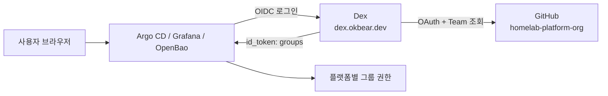

# Dex OIDC 구성과 트러블슈팅

관리 도구 로그인을 GitHub Team 기반 OIDC로 통합한 구성과 적용 절차, 운영 방법, 적용 중 겪은 문제를 정리한다.
빠른 권한 요약은 [관리 도구 접근 권한](access-control.md)을 참고한다.

| 항목 | 내용 |
| --- | --- |
| Issuer | `https://dex.okbear.dev` |
| 사용자 원본 | GitHub org `homelab-platform-org` |
| 그룹 | `platform-admin`, `common-backend` |
| 연동 플랫폼 | Argo CD, Grafana, OpenBao |
| 도입 예정 | Garage UI |
| 적용 PR | hweyoung/homelab#321, #322, #323 |

## 왜 Dex인가

- 사용자 원본을 GitHub로 일원화해 별도 사용자 DB와 백업이 필요 없다.
- 인증 데이터는 Kubernetes CRD에 저장하므로 CNPG 장애와 분리된다.
- 팀원 추가와 제거를 GitHub Team에서 처리한다.
- Authentik, Keycloak은 이 규모에서 운영 부담이 크다. GitHub 계정이 없는 사용자, 서비스별 MFA 정책,
  SAML이나 LDAP이 필요해지면 다시 검토한다. 플랫폼은 표준 OIDC로 연결되므로 issuer, client, 그룹 이름만
  바꾸면 옮길 수 있다.

## 구조



세 곳의 역할을 구분한다.

| 위치 | 결정하는 것 |
| --- | --- |
| GitHub Team | 누가 어느 Team에 속하는가 |
| `gitops/platform/dex/values.yaml` | 어느 Team이 로그인할 수 있고 그룹으로 전달되는가 |
| 플랫폼별 RBAC | 각 그룹이 무엇을 할 수 있는가 |

Dex는 인증과 그룹 전달만 맡는다. Team 멤버는 Dex 설정에 없고, 권한은 플랫폼마다 따로 정해야 한다.
`groups` claim은 `<org>:<team slug>` 형식이며 대소문자까지 일치해야 한다.

### Issuer를 공개 경로에 두는 이유

브라우저뿐 아니라 Argo CD, Grafana, OpenBao Pod도 issuer에 접근한다. 그래서 Dex는 `public-gateway`에 노출하고
Cloudflare Access를 적용하지 않는다. Access를 앞에 두면 Pod의 OIDC discovery가 막힐 수 있다.
로그인은 지정한 org의 Team 멤버로 제한된다.

### 구성 요소

| Application | wave | 경로 | 내용 |
| --- | --- | --- | --- |
| `platform-dex-secrets` | -14 | `gitops/platform/dex/secrets` | GitHub 자격 증명, client secret (SOPS) |
| `platform-dex` | -13 | `gitops/platform/dex/values.yaml` | Dex chart 0.26.0 (Dex 2.46.0) |
| `platform-dex-route` | -12 | `gitops/platform/dex/exposure` | `dex.okbear.dev` HTTPRoute |

Secret을 SOPS에 둔 이유는 OpenBao 장애와 무관하게 Dex가 떠야 하기 때문이다.

## 권한 구성

### 전체 표

| 대상 | `platform-admin` | `common-backend` | 해당 없는 사용자 |
| --- | --- | --- | --- |
| Argo CD | `role:admin` | 로그인 가능, 권한 없음 | Dex에서 거부 |
| Grafana | Org Admin, 모든 폴더 | Viewer, `10 Common Backend` | Dex에서 거부 |
| OpenBao | `platform-admin` 정책 | `secret/apps/common` 하위 읽기·쓰기 (dev, prod) | Dex에서 거부 |
| Garage UI (예정) | 관리자 | 지정 bucket | 기본 거부 |
| bastion SSH | Tailscale SSH | 불가 | 불가 |

Dex의 `teams` 목록에 없는 org 멤버는 Dex 단계에서 거부된다. 관리 지점을 하나 줄이려고 이 목록을 지우면
각 플랫폼의 거부 설정에만 의존하게 되므로 유지한다.

### Argo CD

설정은 Helm release가 소유하며 `ansible/roles/argocd/templates/argocd-values.yaml.j2`에 있다.
변경하면 merge만으로 반영되지 않고 Ansible을 실행해야 한다.

```yaml
rbac:
  policy.default: ""
  scopes: "[groups]"
  policy.csv: |
    g, homelab-platform-org:platform-admin, role:admin
```

- `policy.default`가 비어 있어 매핑되지 않은 사용자는 권한이 없다. `common-backend`는 로그인해도 앱이 보이지 않는다.
- 팀에 프로젝트 권한이 필요해지면 AppProject의 `spec.roles`에 그룹과 정책을 둔다. 이 방식은 GitOps PR만으로
  반영되고 Ansible이 필요 없다. 전역 권한만 `policy.csv`에 둔다.
- client secret은 Secret `dex-argocd-oidc`를 `$dex-argocd-oidc:clientSecret`로 참조한다.
  이 Secret에는 `app.kubernetes.io/part-of: argocd` 라벨이 있어야 한다.
- 모든 컴포넌트와 hook은 `global.nodeSelector`, `global.tolerations`로 prod worker에 배치한다.

### Grafana

```yaml
auth.generic_oauth:
  client_id: grafana
  scopes: openid profile email groups
  role_attribute_strict: true
  role_attribute_path: >-
    contains(groups[*], 'homelab-platform-org:platform-admin') && 'Admin' ||
    contains(groups[*], 'homelab-platform-org:common-backend') && 'Viewer'
```

- `role_attribute_strict: true`로 매핑되지 않은 사용자를 거부한다. 끄면 기본으로 Viewer가 된다.
- `allow_assign_grafana_admin`을 켜지 않았으므로 OIDC 사용자는 서버 관리자가 되지 않는다.
- client secret은 OpenBao `secret/platform/monitoring/grafana`의 `oidc-client-secret`에서 ExternalSecret
  `grafana-oidc`로 동기화한다. 참조가 `optional: true`라 Secret이 없어도 Pod가 뜨고 로컬 admin을 쓸 수 있다.

#### 폴더 권한

| 폴더 | 대상 | Viewer |
| --- | --- | --- |
| `00 Overview`, `01 Infrastructure`, `02 Cluster`, `03 Application` | 플랫폼 관리 | 불가 |
| `10 Common Backend` | `api-common-dev` 고정 대시보드 | 조회 |
| `99 Kubernetes` | chart 기본 대시보드 | 불가 |

Viewer를 `common-backend`만 쓰는 전제로 폴더 권한을 role 기준으로 건다. 폴더 권한은 Git에 선언되지 않으며
새 폴더는 기본으로 Viewer가 볼 수 있으므로, 폴더를 추가하면 아래 스크립트를 다시 실행한다.

마스터 노드 터미널 하나에서 포트 포워딩을 유지한다.

```bash
kubectl -n monitoring port-forward svc/platform-kube-prometheus-stack-grafana 3000:80
```

다른 터미널에서 실행한다. 복사 과정에서 URL에 꺾쇠가 붙지 않도록 주소를 변수로 둔다.

```bash
G=localhost:3000
AUTH="$(kubectl -n monitoring get secret grafana-admin -o jsonpath='{.data.admin-user}' | base64 -d):$(kubectl -n monitoring get secret grafana-admin -o jsonpath='{.data.admin-password}' | base64 -d)"
curl -su "$AUTH" "http://$G/api/folders" | jq -r '.[] | [.uid, .title] | @tsv' | while IFS=$'\t' read -r uid title; do
  if [ "$title" = "10 Common Backend" ]; then items='{"items":[{"role":"Viewer","permission":1}]}'; else items='{"items":[]}'; fi
  code=$(curl -su "$AUTH" -o /dev/null -w '%{http_code}' -X POST -H 'Content-Type: application/json' -d "$items" "http://$G/api/folders/$uid/permissions")
  echo "$code $title"
done
unset AUTH
```

모든 줄이 `200`이어야 한다.

#### 한계

폴더 권한은 **보이는 대시보드만** 제한한다. Team Sync와 데이터소스 권한은 Enterprise 기능이고, OSS의 Viewer는
데이터소스 API로 임의 쿼리를 보낼 수 있다. Loki도 단일 테넌트라 API를 직접 호출하면 다른 namespace의 로그를
조회할 수 있다. 이를 막아야 한다면 아래로 전환한다. 대시보드는 데이터소스를 숨김 변수로 받으므로 JSON을 크게
고치지 않고 옮길 수 있다.

1. `role_attribute_path`를 `org_mapping`으로 바꿔 `common-backend`를 별도 Grafana org에 배정한다.
2. 그 org에 Prometheus 라벨 강제 프록시를 거치는 데이터소스를 만든다.
3. Loki를 멀티 테넌트로 전환하고 namespace별 테넌트를 데이터소스에 지정한다.
4. `10 Common Backend` 대시보드를 새 org에 프로비저닝한다.

### OpenBao

OpenBao 내부 설정은 GitOps로 관리하지 않는다. 아래 명령을 마스터 노드에서 실행하고, 내용을 바꾸면 이 문서도 고친다.

| 정책 | 범위 | 비고 |
| --- | --- | --- |
| `platform-admin` | `path "*"` | 평소 관리자용. 정책 변경 권한이 있어 root와 권한 차이는 작지만 사용자별 토큰과 만료가 남는다 |
| `common-backend` | `apps/common` 하위 | dev, prod 읽기·쓰기, 영구 삭제 없음 |

`common-backend`가 prod 값을 바꾸면 ESO가 동기화 주기 안에 Kubernetes Secret에 반영한다. 잘못된 값은 앱 재시작 때
운영 장애가 될 수 있다. `destroy`와 metadata 삭제 권한은 복구를 위해 주지 않았다.

상위 경로 목록 권한이 없으므로 팀원은 메뉴로 찾아 들어갈 수 없다. Role을 `common-backend`로 로그인한 뒤 주소창에
`https://openbao.okbear.dev/ui/vault/secrets/secret/kv/list/apps/common/`를 직접 입력한다.

### Garage UI (예정)

Garage는 키-버킷 단위 권한만 있고 버킷 정책을 지원하지 않는다. `garage-ui`의 `bucket_prefixes`도 **버킷 이름 접두사**이며
버킷 내부 폴더 단위 제한으로 보지 않는다. 도입할 때 주의한다.

- `common-dev`처럼 전용 버킷을 정확한 이름으로 지정한다. `common-`은 다른 버킷까지 포함할 수 있다.
- `garage-ui` 문서상 이 기능은 보안 경계가 아니다. UI 내부의 단일 토큰과 S3 키를 가진 사람은 우회할 수 있으므로
  애플리케이션 S3 키는 버킷별로 분리한다.
- Dex의 `staticClients`에 client를 추가하고 `admin_roles`에 `homelab-platform-org:platform-admin`을 넣는다.

### bastion SSH

Dex나 GitHub Team으로 제어되지 않는다. Tailscale 정책과 bastion의 sshd 설정(LAN 포트 1022)을 별도로 관리한다.

## 적용 절차

새 환경을 만들거나 다시 구성할 때의 순서다. 각 단계의 실패 사례는 [트러블슈팅](#트러블슈팅)을 참고한다.

### 1. GitHub 준비

1. org를 만들고 Team `platform-admin`, `common-backend`를 만든다. 저장소는 개인 계정에 그대로 둬도 된다.
2. org **Settings → Member privileges**에서 Base permissions를 `No permission`으로 둔다.
3. **Settings → Authentication security**에서 2FA 필수를 켠다. 2FA가 없는 멤버는 제거될 수 있다.
4. **Settings → Developer settings → OAuth Apps**에서 앱을 등록한다.

| 항목 | 값 |
| --- | --- |
| Homepage URL | `https://dex.okbear.dev` |
| Authorization callback URL | `https://dex.okbear.dev/callback` |
| Enable Device Flow | 끔 |

OAuth App은 **org 소유**여야 한다. 새 org는 OAuth App 접근 제한이 기본으로 켜져 있고, org 소유 앱만 자동으로 접근 권한을 받는다.
owner도 Team에 들어 있어야 권한이 생긴다. Team 생성자가 자동으로 멤버가 될 수 있으니 소속을 확인한다.

```bash
gh api orgs/homelab-platform-org/teams/platform-admin/members --jq '.[].login'
```

### 2. Secret 입력

age 개인키가 있는 환경에서 실행한다. 값은 프롬프트 없이 입력을 기다리며 화면에 표시되지 않는다.

```bash
read -rs V; sops set gitops/platform/dex/secrets/dex-env.sops.yaml '["stringData"]["GITHUB_CLIENT_ID"]' "\"$V\""; unset V
```

```bash
read -rs V; sops set gitops/platform/dex/secrets/dex-env.sops.yaml '["stringData"]["GITHUB_CLIENT_SECRET"]' "\"$V\""; unset V
```

client secret은 무작위로 만든다. `ARGOCD_CLIENT_SECRET`, `GRAFANA_CLIENT_SECRET`, `OPENBAO_CLIENT_SECRET`을 같은 방식으로 넣는다.

```bash
sops set gitops/platform/dex/secrets/dex-env.sops.yaml '["stringData"]["OPENBAO_CLIENT_SECRET"]' "\"$(openssl rand -hex 32)\""
```

Argo CD 값은 두 파일에 같아야 한다.

```bash
[ "$(sops -d --extract '["stringData"]["clientSecret"]' gitops/clusters/homelab/argocd-server/argocd-oidc.sops.yaml)" = "$(sops -d --extract '["stringData"]["ARGOCD_CLIENT_SECRET"]' gitops/platform/dex/secrets/dex-env.sops.yaml)" ] && echo 일치 || echo 불일치
```

**CI는 암호화된 파일 안의 `REPLACE_ME`를 검출하지 못한다.** 또한 Dex는 `secretEnv` 값이 없어도 빈 값으로 기동하므로
merge 전에 모든 키를 확인한다.

### 3. merge 전 외부 설정

- OpenBao `secret/platform/monitoring/grafana`에 `oidc-client-secret`을 추가한다. 값은 `GRAFANA_CLIENT_SECRET`과 같아야 한다.
  UI에서 새 버전을 저장할 때 `admin-user`, `admin-password`가 빠지지 않게 한다.
- Cloudflare Tunnel에 `dex.okbear.dev`를 추가한다. Service는 다른 관리 도구 경로와 같게 두고 Access는 적용하지 않는다.

### 4. merge와 확인

Dex, Grafana는 Argo CD가 동기화한다.

```bash
kubectl -n dex get pods,httproute
```

```bash
curl -s -o /dev/null -w '%{http_code}\n' https://dex.okbear.dev/.well-known/openid-configuration
```

`200`이어야 한다.

```bash
kubectl -n monitoring get externalsecret grafana-oidc
```

### 5. Argo CD 반영

Ansible은 실행하는 체크아웃의 템플릿을 쓰므로 최신 `main`인지 먼저 확인한다.

```bash
make -C ansible argocd-upgrade-precheck
```

```bash
make -C ansible argocd-upgrade-reconcile
```

Ansible은 Helm 배포 전에 모든 Application이 Synced, Healthy인지 검사한다. `argocd_health_exempt_applications`는 Health만
제외하고 Sync는 모든 Application에 적용된다.

### 6. OpenBao 구성

마스터 노드에서 저장소나 `sops` 없이 실행할 수 있다. 값은 클러스터의 Secret에서 읽어 표준 입력으로 넘겨, 명령 인자에 드러나지 않게 한다.
`bao`는 `platform-openbao-0` Pod 안에서 실행한다.

```bash
kubectl -n openbao exec -it platform-openbao-0 -- bao login
```

```bash
kubectl -n openbao exec platform-openbao-0 -- bao auth enable -path=oidc -listing-visibility=unauth jwt
```

```bash
printf '{"oidc_discovery_url":"https://dex.okbear.dev","oidc_client_id":"openbao","oidc_client_secret":"%s","default_role":"common-backend"}' "$(kubectl -n dex get secret dex-env -o jsonpath='{.data.OPENBAO_CLIENT_SECRET}' | base64 -d)" | kubectl -n openbao exec -i platform-openbao-0 -- bao write auth/oidc/config -
```

정책은 Pod 셸에서 작성한다.

```bash
kubectl -n openbao exec -it platform-openbao-0 -- sh
```

```bash
bao policy write platform-admin - <<'EOF'
path "*" {
  capabilities = ["create", "read", "update", "patch", "delete", "list", "sudo"]
}
EOF
```

```bash
bao policy write common-backend - <<'EOF'
path "secret/data/apps/common/*" {
  capabilities = ["create", "read", "update", "patch", "delete"]
}
path "secret/metadata/apps/common/*" {
  capabilities = ["read", "list"]
}
path "secret/delete/apps/common/*" {
  capabilities = ["update"]
}
path "secret/undelete/apps/common/*" {
  capabilities = ["update"]
}
EOF
```

역할은 주소를 변수로 조립한다. 복사 과정에서 URL이 `<https://...>`로 바뀌는 문제를 막기 위해서다. 마스터 노드에서 실행한다.

```bash
H=openbao.okbear.dev; printf '{"role_type":"oidc","user_claim":"sub","bound_audiences":["openbao"],"bound_claims":{"groups":["homelab-platform-org:platform-admin"]},"oidc_scopes":["profile","email","groups"],"allowed_redirect_uris":["https://%s/ui/vault/auth/oidc/oidc/callback","http://localhost:8250/oidc/callback"],"token_policies":["platform-admin"],"token_ttl":"8h"}' "$H" | kubectl -n openbao exec -i platform-openbao-0 -- bao write auth/oidc/role/platform-admin -
```

```bash
H=openbao.okbear.dev; printf '{"role_type":"oidc","user_claim":"sub","bound_audiences":["openbao"],"bound_claims":{"groups":["homelab-platform-org:common-backend"]},"oidc_scopes":["profile","email","groups"],"allowed_redirect_uris":["https://%s/ui/vault/auth/oidc/oidc/callback","http://localhost:8250/oidc/callback"],"token_policies":["common-backend"],"token_ttl":"8h"}' "$H" | kubectl -n openbao exec -i platform-openbao-0 -- bao write auth/oidc/role/common-backend -
```

끝나면 Pod에 저장된 관리자 토큰을 지운다. root 토큰이면 폐기하지 않는다.

```bash
kubectl -n openbao exec platform-openbao-0 -- sh -c 'rm -f "$HOME/.vault-token"'
```

### 7. Grafana 폴더 권한과 검증

[폴더 권한](#폴더-권한) 스크립트를 실행한 뒤, 팀원을 초대하기 전에 아래를 확인한다.

| 항목 | 기대 결과 |
| --- | --- |
| 로컬 admin (Argo CD, Grafana) | 로그인 가능 |
| `platform-admin` → Argo CD | 전체 앱 표시, User Info에 그룹 표시 |
| `platform-admin` → Grafana | Org Admin |
| `platform-admin` → OpenBao | 전체 경로 조회 |
| `common-backend` → Argo CD | 로그인 가능, 앱 없음 |
| `common-backend` → Grafana | Viewer, `10 Common Backend`만 표시 |
| `common-backend` → OpenBao | `apps/common` 하위만 접근, `platform/monitoring` 거부 |
| Team에 없는 org 멤버 | Dex에서 거부 |

한 계정을 Team에 넣고 빼며 시험할 때는 로그아웃 후 다시 로그인한다. Dex는 로그인할 때 Team을 읽으므로 기존 세션에는
변경이 바로 반영되지 않을 수 있다.

## 운영

### 팀원 추가와 제거

- 추가: org에 초대하고 Team에 넣는다. 초대는 7일 뒤 만료되며 수락 전에는 로그인할 수 없다.
- 제거: Team에서 뺀다. 이미 로그인한 세션은 만료 전까지 남을 수 있으므로 즉시 차단이 필요하면 세션도 끊는다.
  OpenBao 토큰은 TTL이 8시간이지만 갱신될 수 있으므로, 즉시 차단하려면 해당 토큰을 폐기한다. tailnet을 쓰면 Tailscale 사용자와 `group:common-backend`도 함께 정리한다.

### 새 Team 추가

1. GitHub에 Team을 만든다.
2. `dex/values.yaml`의 `teams`에 추가한다.
3. 플랫폼별 권한을 추가한다. Grafana는 `role_attribute_path`, OpenBao는 역할과 정책, Argo CD는 AppProject `spec.roles`다.

### 새 플랫폼 추가

1. `dex/values.yaml`의 `staticClients`에 client와 redirect URI를 추가한다.
2. `dex-env.sops.yaml`에 `secretEnv`로 지정한 값을 추가한다.
3. 플랫폼에 OIDC를 설정하고 `<org>:<team slug>` 그룹을 권한에 매핑한다. 기본 거부로 설정한다.
4. OIDC를 지원하지 않으면 `oauth2-proxy`를 앞단에 둔다.
5. 권한표와 이 문서를 고친다.

Dex 설정 변경 후에는 Pod가 다시 떠서 새 Secret 값을 읽었는지 확인한다.

### client secret 교체

| 대상 | 값을 바꿀 곳 | 반영 |
| --- | --- | --- |
| Argo CD | `dex-env.sops.yaml`, `argocd-oidc.sops.yaml` 둘 다 | merge 후 Dex와 argocd-server 재시작 |
| Grafana | `dex-env.sops.yaml`, OpenBao `oidc-client-secret` | ESO 동기화 후 Dex와 Grafana 재시작 |
| OpenBao | `dex-env.sops.yaml`, `auth/oidc/config` | Dex 재시작 후 [OpenBao 구성](#6-openbao-구성)의 config 명령 재실행 |
| GitHub OAuth | GitHub에서 재발급, `dex-env.sops.yaml` | Dex 재시작 |

### 장애 시 접근

Dex나 GitHub에 장애가 나도 아래 경로는 쓸 수 있어야 한다. 정기적으로 확인한다.

| 대상 | 비상 경로 |
| --- | --- |
| Argo CD | 로컬 `admin` |
| Grafana | 로컬 admin (`grafana-admin` Secret) |
| OpenBao | 복구 수단으로 보관한 관리자 토큰 |
| Kubernetes | 마스터 노드 kubeconfig |

Grafana admin 비밀번호는 DB를 처음 만들 때만 반영되므로 UI에서 바꾸면 Secret 값과 달라질 수 있다.

## 트러블슈팅

### 로그인과 권한

| 증상 | 원인 | 조치 |
| --- | --- | --- |
| OpenBao `Missing auth_url` | 역할의 `allowed_redirect_uris`가 UI 콜백과 다름. 복사 중 `<https://...>`로 저장된 사례 | 역할을 다시 쓴다. 접속 주소가 정확히 `https://openbao.okbear.dev`인지 확인 |
| Argo CD에 GitHub 로그인 버튼 없음 | Helm release에 미반영 | `argocd-upgrade-reconcile` 실행 |
| Argo CD 로그인 후 앱이 안 보임 | RBAC 미반영이나 기존 세션 | `argocd-rbac-cm` 확인 후 재로그인 |
| Grafana 로그인 거부 | 그룹 매핑 없음(strict) | Team 소속과 `role_attribute_path` 확인 |
| Grafana GitHub 로그인만 실패 | Secret이 Pod 기동 후 생성되어 값이 비어 있음 | 아래 "Grafana client secret 반영 확인" 참고 |
| Dex에서 로그인 거부 | Team 미소속, 초대 미수락 | Team 소속 확인. owner도 Team에 있어야 함 |
| 그룹이 비어 있음 | 개인 계정 소유 OAuth App이 접근 제한에 걸림 | org 소유 앱으로 등록 |
| Team 변경이 반영되지 않음 | 기존 세션 유지 | 로그아웃 후 재로그인 |

역할 값은 아래로 확인한다.

```bash
kubectl -n openbao exec platform-openbao-0 -- bao read -field=allowed_redirect_uris auth/oidc/role/platform-admin
```

UI와 같은 요청으로 로그인 URL 생성을 시험한다. `auth_url`에 `https://dex.okbear.dev/auth?...`가 나오면 정상이다.

```bash
H=openbao.okbear.dev; kubectl -n openbao exec platform-openbao-0 -- bao write auth/oidc/oidc/auth_url role=platform-admin redirect_uri="https://$H/ui/vault/auth/oidc/oidc/callback"
```

Argo CD RBAC는 아래로 확인한다.

```bash
kubectl -n argocd get cm argocd-rbac-cm -o jsonpath='{.data.policy\.csv}{"\n"}{.data.scopes}{"\n"}'
```

#### Grafana client secret 반영 확인

Grafana 컨테이너에는 `sh`가 없어 `kubectl exec`로 환경변수를 볼 수 없다.
(`exec: "sh": executable file not found`) 컨테이너 시작 시각이 Secret 생성 시각보다 늦으면 반영된 것이다.

```bash
kubectl -n monitoring get secret grafana-oidc -o jsonpath='{.metadata.creationTimestamp}{"\n"}'
```

```bash
kubectl -n monitoring get pod -l app.kubernetes.io/name=grafana -o jsonpath='{range .items[*]}{.metadata.name}{" "}{.status.containerStatuses[?(@.name=="grafana")].state.running.startedAt}{"\n"}{end}'
```

컨테이너가 더 빠르면 재시작한다.

```bash
kubectl -n monitoring rollout restart deployment/platform-kube-prometheus-stack-grafana
```

### Dex 배포와 경로

| 증상 | 원인 | 조치 |
| --- | --- | --- |
| `dex.okbear.dev` HTTP 525 | 배포 전 라우트 없음. 배포 후 `200`으로 해소 | Pod와 HTTPRoute 확인, 계속되면 Tunnel 설정을 다른 관리 도구 경로와 비교 |
| Dex는 뜨는데 client 인증 실패 | `secretEnv` 값 누락(빈 값으로 기동) | `dex-env` 키 확인 후 Pod 재시작 |

키 존재 여부와 값 길이만 확인한다.

```bash
kubectl -n dex get secret dex-env -o jsonpath='{.data.OPENBAO_CLIENT_SECRET}' | base64 -d | wc -c
```

### Argo CD 배포

| 증상 | 원인 | 조치 |
| --- | --- | --- |
| `pre-upgrade hooks failed: timed out` | `argocd-redis-secret-init` Pod Pending, 세 노드 taint | `global.nodeSelector`, `global.tolerations` 적용 (#323) |
| `Upgrade 전 모든 ArgoCD Pod Ready 검증` 실패 | 이전 실패로 Pending Job이 남음. Helm이 지우기 전에 Ansible이 먼저 검사 | Job 삭제 후 재실행 |
| `Upgrade 전 모든 Application Synced/Healthy 검증` 실패 | 다른 Application 이상 | 원인을 고친다. 예외 목록은 Sync를 제외하지 못함 |

재실행 전에 원인을 먼저 본다. `--atomic`으로 실패 시 이전 revision으로 롤백된다.

```bash
kubectl -n argocd describe pod -l app.kubernetes.io/name=argocd-redis-secret-init
```

```bash
helm -n argocd history argocd --max 5
```

`0/3 nodes are available: 3 node(s) had untolerated taint(s)`가 보였던 사례다. 기존 Pod는 taint 적용 전에 떠 있어 61일간
문제가 드러나지 않았고, 재시작했다면 같은 이유로 Argo CD가 내려갈 수 있었다.

남은 hook Job은 실행된 적이 없으면 지워도 안전하다.

```bash
kubectl -n argocd delete job argocd-redis-secret-init
```

Synced, Healthy가 아닌 Application은 아래로 찾는다. `argocd-control-plane`은 Health만 예외다.

```bash
kubectl -n argocd get applications --no-headers -o custom-columns=NAME:.metadata.name,SYNC:.status.sync.status,HEALTH:.status.health.status | grep -v 'Synced *Healthy'
```

### Ansible 점검을 막은 Application

| Application | 증상 | 원인 | 조치 |
| --- | --- | --- | --- |
| `platform-garage` | `spec.selector ... field is immutable` | #318의 selector 변경이 적용되지 못함 | Deployment 삭제 후 sync. PVC 유지, 잠시 중단 |
| `platform-monitoring-secrets` | `alertmanager-discord` Degraded, `Secret does not exist` | OpenBao 경로에 값 없음 | 값 입력 후 `force-sync` |
| `platform-kargo` | OutOfSync, Missing | 도입 전 상태 | root-app에서 주석 처리 (#322) |

```bash
kubectl -n garage delete deployment garage
```

자동으로 다시 만들어지지 않으면 sync한다.

```bash
argocd app sync platform-garage
```

```bash
kubectl -n monitoring annotate externalsecret alertmanager-discord force-sync="$(date +%s)" --overwrite
```

Secret이 생기면 `Init:0/1`에 멈춘 Alertmanager Pod도 진행한다. 진행되지 않으면 Pod를 지워 StatefulSet이 다시 만들게 한다.

Kargo Application을 제거하면 root-app의 prune과 삭제 finalizer로 리소스도 함께 삭제된다. CRD가 지워지면 CR도 사라질 수 있으므로
직접 만든 리소스를 먼저 확인한다. 다시 켤 때는 root-app의 주석을 해제한다.

### SOPS와 Git

| 증상 | 원인 | 조치 |
| --- | --- | --- |
| `Failed to get the data key` | 이 셸에 age 개인키 없음 | `SOPS_AGE_KEY_FILE` 지정. `.sops.yaml`의 공개키와 비교 |
| 일반 push 거부 후 `git pull`을 하니 커밋 분리가 사라짐 | rebase pull이 같은 내용의 커밋을 빈 커밋으로 제거 | reflog에서 커밋을 찾아 `--force-with-lease`로 push |
| 역할별 커밋이 `main`에서 하나로 합쳐짐 | Squash merge | Rebase and merge 또는 Create a merge commit 사용 |
| merge된 브랜치에 올린 커밋이 `main`에 없음 | PR이 이미 merge됨 | `main` 기준 새 브랜치로 옮김 |

공개키를 확인한다. 개인키 내용은 출력하지 않는다.

```bash
age-keygen -y "$SOPS_AGE_KEY_FILE"
```

이력을 덮어쓸 때는 대상 커밋을 명시해 다른 커밋을 지우지 않게 한다.

```bash
git push --force-with-lease='<branch>:<기존 원격 커밋 전체 SHA>' origin '<분리한 커밋 SHA>:refs/heads/<branch>'
```

### CI

| 증상 | 원인 | 조치 |
| --- | --- | --- |
| `You have to deploy monitoring.coreos.com/v1` | 클러스터 없는 `helm template`이 ServiceMonitor API를 모름 | `--api-versions monitoring.coreos.com/v1` 지정 (#322) |
| 평문 스캔에 `clientSecret: $GITHUB_CLIENT_SECRET` 검출 | 환경변수 참조를 평문으로 판단 | 값 전체가 `$ENV_VAR`인 줄만 제외 |
| 뒤쪽 검사 결과가 없음 | 앞 단계 실패로 작업 중단 | 앞 단계부터 해결. 암호화 값은 CI가 검증하지 못함 |

### 터미널 복사 문제

문서나 채팅의 URL을 복사하면 `<http://...>`처럼 꺾쇠가 붙을 수 있다. 셸에서는 `syntax error near unexpected token`으로 나타나고,
JSON에서는 잘못된 값이 그대로 저장되어 나중에 다른 오류로 드러난다. 주소는 변수로 조립하거나, 저장된 값을 읽어 확인한다.

## 검증 범위

| 항목 | 상태 |
| --- | --- |
| Dex, Argo CD, Grafana, OpenBao GitHub 로그인 | 관리자 계정으로 확인 |
| `common-backend` 권한 | 같은 계정의 Team 소속을 바꿔 확인 |
| 실제 팀원 계정, Team 없는 org 멤버 | 미확인 |
| Garage UI | 미도입 |
| Tailscale 경로 | 미적용, 현재 관리 도구는 공개 경로와 Cloudflare Access 사용 중 |

Cloudflare Access가 켜져 있는 동안에는 Access와 플랫폼 로그인을 각각 거치므로 이중 로그인이 남는다.
