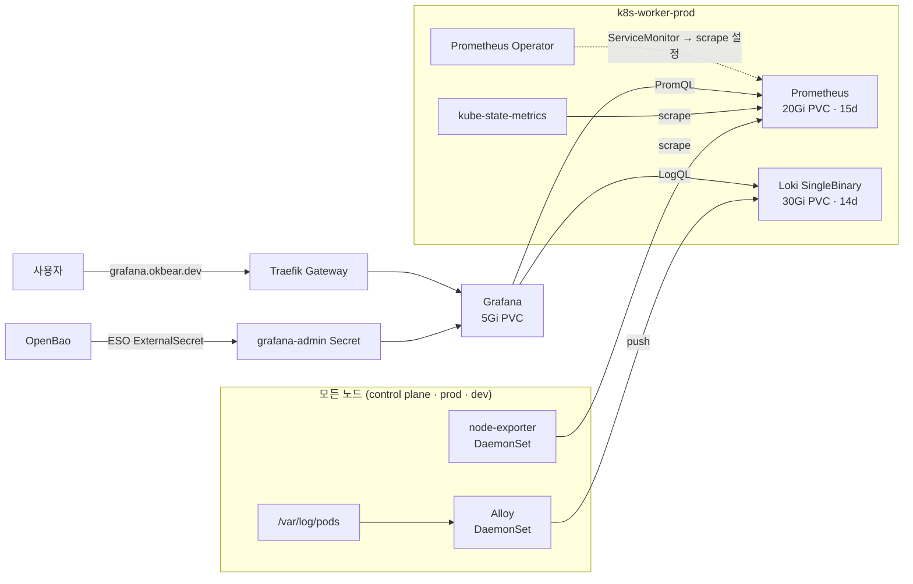
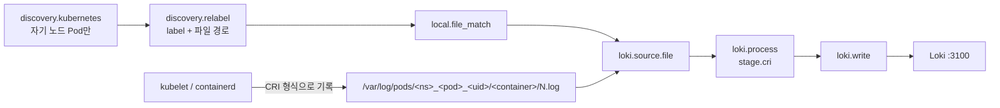
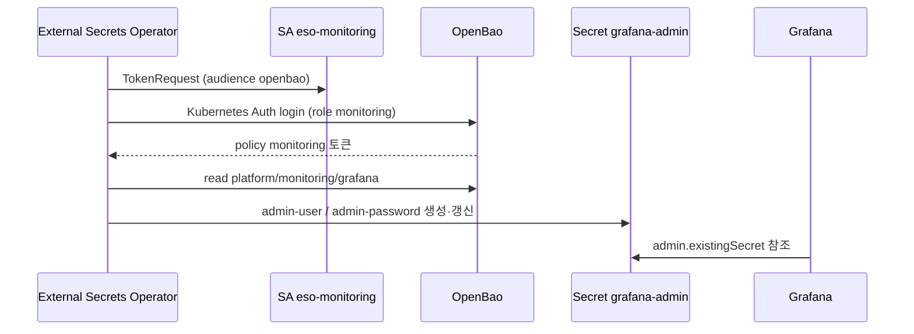

# Observability 구성

홈랩 클러스터의 metric과 로그 수집 구성을 정리한다. 각 구성 요소의 역할, 이 환경에서
선택한 방식과 이유, 배포 중 만난 문제를 함께 기록해 이후 운영과 글 작성의 근거로 쓴다.
배포 선언은 `gitops/platform/monitoring/`, 운영 절차는 같은 경로의 README를 기준으로 한다.

## 한눈에 보기



| 구분 | 수집 방식 | 저장소 | 조회 |
| --- | --- | --- | --- |
| Metric | Prometheus가 각 target을 주기적으로 pull(scrape) | Prometheus TSDB | Grafana(PromQL) |
| Log | Alloy가 노드의 로그 파일을 읽어 Loki로 push | Loki(filesystem) | Grafana(LogQL) |

## 구성 요소

### Prometheus

시계열 metric 데이터베이스다. 대상의 `/metrics` endpoint를 주기적으로 가져와(pull) label이
붙은 시계열로 저장하고 PromQL로 조회한다. 알림 rule도 Prometheus가 평가한다.

### Prometheus Operator와 kube-prometheus-stack

Prometheus Operator는 Prometheus 설정을 Kubernetes 리소스로 관리하게 해 준다.
`ServiceMonitor`, `PodMonitor`, `PrometheusRule` 같은 CRD를 만들면 operator가 이를 읽어
Prometheus scrape 설정과 rule로 변환한다. 새 서비스를 수집하려면 Prometheus 설정 파일을
고치는 대신 해당 서비스 옆에 ServiceMonitor를 하나 두면 된다.

kube-prometheus-stack은 operator, Prometheus, Grafana, kube-state-metrics, node-exporter와
Kubernetes 기본 dashboard·alert rule을 한 번에 설치하는 Helm chart다.

### node-exporter와 kube-state-metrics

| exporter | 관점 | 예 |
| --- | --- | --- |
| node-exporter | 노드 OS | CPU, memory, disk, network, filesystem 사용량 |
| kube-state-metrics | Kubernetes object 상태 | Deployment replica, Pod phase, restart 횟수, PVC 상태 |

node-exporter는 노드마다 하나씩 DaemonSet으로 뜨고, kube-state-metrics는 API server를
watch하는 Deployment 하나다. kubelet/cAdvisor의 container metric은 operator가 만든 kubelet
Service로 별도 수집한다.

### Grafana

metric과 로그를 시각화하는 UI다. Prometheus와 Loki를 데이터소스로 연결해 dashboard와
Explore 화면에서 조회한다. kube-prometheus-stack은 Kubernetes 기본 dashboard를 ConfigMap으로
함께 배포하고 Grafana sidecar가 이를 자동으로 불러온다.

### Loki

로그 저장소다. 로그 본문 전체를 색인하지 않고 `namespace`, `pod` 같은 label만 색인하며,
본문은 압축 chunk로 저장한다. 그래서 저장 비용이 작고 Prometheus와 같은 label 모델로 metric과
로그를 오갈 수 있다. 조회 언어는 LogQL이다.

배포 모드는 세 가지다.

| 모드 | 구조 | 용도 |
| --- | --- | --- |
| SingleBinary | 모든 기능이 Pod 하나 | 소규모, filesystem 저장 |
| SimpleScalable | read/write/backend 3그룹 | 중간 규모, object storage 필요 |
| Distributed | 기능별 microservice | 대규모 |

### Alloy

Grafana의 telemetry 수집 agent다. Promtail(유지보수 종료)과 Grafana Agent의 후속이며,
metric·로그·trace를 하나의 agent로 수집할 수 있다. 설정은 component를 block으로 선언하고 서로의 출력을 연결하는 Alloy configuration syntax로 쓴다.
이 환경에서는 로그 수집만 맡긴다.

## 이 환경의 구성

### 배포 단위

모든 리소스는 Argo CD root-app(App-of-Apps)에 Application으로 등록되어 있다. 외부 Helm
chart는 chart와 Git의 values 파일을 묶은 multi-source Application이고, chart 버전은 root-app
`platformVersions`에서 관리한다.

| wave | Application | 종류 | 경로 | 내용 |
| ---: | --- | --- | --- | --- |
| -50 | `namespaces` | Helm(내부) | `platform/namespaces` | `monitoring` Namespace |
| -8 | `platform-monitoring-secrets` | Kustomize | `monitoring/external-secrets` | SA, SecretStore, ExternalSecret |
| -7 | `platform-kube-prometheus-stack` | Helm 92.14.0 | `monitoring/values.yaml` | CRD, operator, Prometheus, Grafana, exporter |
| -6 | `platform-grafana-route` | Kustomize | `monitoring/exposure` | Grafana HTTPRoute |
| -6 | `platform-loki` | Helm 7.5.0 (Loki 3.6.16) | `monitoring/loki/values.yaml` | Loki StatefulSet |
| -5 | `platform-alloy` | Helm 1.14.3 (Alloy 1.21.2) | `monitoring/alloy/values.yaml` | Alloy DaemonSet |

Namespace는 `namespaces` Application이 소유한다. 위 monitoring Application은 Namespace를 직접
만들지 않는 `platform-existing-namespace` sync 정책을 쓴다. `monitoring` Namespace는 외부
route를 받기 때문에 `gatewayAccess: public` label을 갖는다. 공용 Gateway는 이 label이 있는
Namespace의 HTTPRoute만 허용한다.

### 노드 배치

클러스터는 control plane 1대와 prod/dev Worker 각 1대이며, Worker에는
`homelab.okbear.dev/environment=prod|dev:NoSchedule` taint가 걸려 있다.

| 구성 요소 | 배치 | 이유 |
| --- | --- | --- |
| Prometheus, operator, kube-state-metrics | prod Worker 고정 | 다른 플랫폼 구성 요소와 같은 안정 노드 |
| Loki | prod Worker 고정 | 로그 PVC를 안정 노드에 둔다 |
| Grafana | prod/dev taint 모두 허용 | UI는 어느 Worker에 떠도 무방하다 |
| node-exporter, Alloy | 모든 노드 | 노드 단위 수집이라 control plane까지 포함한다 |

Grafana는 nodeSelector 없이 두 taint를 모두 허용한다. 다만 `local-path` PV는 처음 생성된
노드에 묶이므로, 최초 배치 이후에는 그 노드에서만 다시 뜬다.

### Metric 수집

- Prometheus는 chart release label이 없는 ServiceMonitor, PodMonitor, PrometheusRule도
  선택한다(`*SelectorNilUsesHelmValues: false`). 다른 Application이 만든 ServiceMonitor도
  별도 label 없이 수집된다. Loki와 Alloy도 이 방식으로 자기 metric을 노출한다.
- 저장은 `local-path` 20Gi PVC이고 보존 기간은 15일 또는 18GB 중 먼저 닿는 쪽이다.
- Traefik, cert-manager, External Secrets, CNPG operator는 chart 옵션으로 ServiceMonitor/PodMonitor를
  켰고, PostgreSQL Cluster는 `databases/postgres/base`에 PodMonitor를 직접 선언했다. CNPG Cluster의
  `monitoring.enablePodMonitor`는 deprecated다.
- Kubespray 기본 구성에서 수집할 수 없는 target은 비활성화했다.
  - etcd는 host systemd 서비스이고 metrics endpoint가 mTLS client 인증서를 요구한다.
  - kube-proxy metrics는 `127.0.0.1:10249`에만 bind된다.
  - 이 둘을 켜 두면 target이 항상 down이어서 경고만 늘어난다.
- controller-manager와 scheduler는 켜 두었다. bind 주소에 따라 down일 수 있어 sync 후
  Targets 화면에서 확인한다.

### 알림

- Alertmanager는 alert를 `namespace`, `alertname`으로 묶어 Discord로 보낸다. critical은 1시간,
  warning은 12시간마다 다시 알린다.
- `Watchdog`, `InfoInhibitor`, info 등급은 Discord로 보내지 않는다. 항상 울리거나 참고용이라
  채널을 소음으로 채우기 때문이다.
- Discord webhook URL은 OpenBao `secret/platform/monitoring/alertmanager`에 두고 ESO가
  `alertmanager-discord` Secret으로 동기화한다. Alertmanager는 이 Secret을 파일로 mount해
  `webhook_url_file`로 읽어 URL이 Git이나 렌더된 설정에 남지 않는다.
- Alertmanager도 prod Worker에서 돌기 때문에 그 노드가 죽으면 알림도 멈춘다.

### 로그 수집



- Alloy는 DaemonSet이고 각 Pod는 `spec.nodeName=$HOSTNAME` selector로 **자기 노드의 Pod만**
  찾는다. 노드마다 Alloy가 있으므로 같은 로그를 중복 수집하지 않는다.
- Pod metadata로 `namespace`, `pod`, `container`, `app`, `node` label을 붙이고, Pod UID와
  container 이름으로 `/var/log/pods` 아래 로그 파일 경로를 만든다. host의 `/var/log`를
  읽기 위해 chart의 `mounts.varlog`를 켰다.
- `stage.cri`가 containerd 로그 형식(`timestamp stream flag message`)을 풀어 원래 로그 줄과
  timestamp를 복원한다.
- 전송 대상은 클러스터 내부 Service `platform-loki.monitoring:3100`이다.

Loki는 SingleBinary 1개 Pod로 운영한다.

| 설정 | 값 | 이유 |
| --- | --- | --- |
| 저장소 | `local-path` 30Gi PVC, filesystem | Prometheus와 같은 내구성 수준, 추가 Secret 불필요 |
| 보존 | 14일, compactor retention | 디스크 사용량 상한 |
| 인증 | `auth_enabled: false` | 단일 테넌트, 클러스터 내부 전용 |
| schema | TSDB index, v13 | 현재 권장 schema |
| PVC 정책 | `whenDeleted/whenScaled: Retain` | Application 삭제나 replica 조정으로 로그를 잃지 않는다 |
| 비활성 | memcached cache, nginx gateway, canary/test | 단일 Pod 규모에는 불필요 |

Garage S3를 object storage로 쓰는 방식도 검토했다. Garage 역시 single-node `local-path` 위에
있어 실제 내구성 차이가 작고, bucket과 access key를 OpenBao/ESO로 추가 관리해야 해서
filesystem을 선택했다.

### Grafana 접근과 Secret

- `grafana.okbear.dev` HTTPRoute가 공용 `public-gateway`의 http/https listener에 붙는다.
  TLS는 Gateway의 `*.okbear.dev` wildcard 인증서가 종료한다.
- 익명 접근과 회원 가입은 끄고, admin 계정 하나로 로그인한다.
- admin 계정은 Git에 두지 않는다. OpenBao KV v2 `secret/platform/monitoring/grafana`에 저장하고
  External Secrets Operator가 `grafana-admin` Secret으로 동기화한다.



이 흐름은 api-common dev 앱의 OpenBao + ESO 전환과 같은 구조다. ServiceAccount(wave -3),
SecretStore(-2), ExternalSecret(-1) 순서로 적용하고, SA token은 Pod에 mount하지 않는다.
Grafana는 admin 값을 최초 DB 생성 시에만 반영하므로, PVC가 이미 있는 상태에서 값을 바꾸면
`grafana cli admin reset-admin-password`로 맞춘다.

### Grafana 데이터소스

| 이름 | 종류 | 주소 |
| --- | --- | --- |
| Prometheus | prometheus | chart 기본값(`kube-prometheus-stack-prometheus`) |
| Loki | loki | `http://platform-loki.monitoring:3100` |

## 배포 중 만난 문제와 결정

### Helm release 이름 잘림

Argo CD는 Application 이름을 Helm release 이름으로 쓰므로 release는
`platform-kube-prometheus-stack`(30자)이 된다. kube-prometheus-stack은 리소스 이름을 26자로
자르기 때문에 `platform-kube-prometheus-s` 같은 이름이 생긴다. `fullnameOverride:
kube-prometheus-stack`으로 고정했다. Grafana, kube-state-metrics 같은 subchart는 자기 규칙을
따르므로 `platform-kube-prometheus-stack-grafana`처럼 release 이름이 그대로 붙는다.

### `kube-system` destination

chart가 coredns, controller-manager, scheduler scrape용 Service를 `kube-system`에 만든다.
platform AppProject의 destination에 `kube-system`이 없으면 sync가 거부되므로 추가했다.

### `namespaces "monitoring" not found`

첫 배포에서 세 monitoring Application이 모두 이 오류로 실패했다. sync wave는 Application을
만드는 순서일 뿐이고, 앞 wave의 `namespaces` Application이 새 commit을 반영해 Namespace를
만들었다는 보장은 아니다. `namespaces`가 sync된 뒤 monitoring Application을 다시 sync해
해결했다. 자동 sync는 같은 revision의 재시도 횟수를 다 쓰면 다시 시도하지 않으므로 수동 sync가
필요할 수 있다.

### AppProject 삭제 표시

진단 중 `platform`, `apps-dev`, `apps-prod` AppProject에 2026-08-02부터 deletionTimestamp가
붙어 있는 것을 발견했다. 이 프로젝트를 쓰는 Application이 남아 있어 finalizer가 실제 삭제를
막고 있고, 당장 서비스에는 영향이 없다. monitoring 구성과는 별개 문제로 따로 정리한다.

### CI 평문 Secret 검사

`gitops-validate.yml`은 `^kind: Secret` 패턴으로 평문 Secret을 찾는데 `kind: SecretStore`도
이 패턴에 걸렸다. api-common과 monitoring의 SecretStore 모두 해당했고, 패턴 끝을 고정해
해결했다. 상세는 [GitOps 검증](validation.md)을 참고한다.

## 검증

```bash
kubectl -n monitoring get pod,pvc
kubectl -n monitoring wait --for=condition=Ready externalsecret/grafana-admin --timeout=120s
kubectl -n monitoring get prometheus,servicemonitor
kubectl -n monitoring rollout status daemonset/platform-alloy
kubectl -n monitoring port-forward svc/kube-prometheus-stack-prometheus 9090
```

- Prometheus UI Status → Targets에서 down target이 없는지 본다.
- `https://grafana.okbear.dev`에서 로그인하고 Kubernetes 기본 dashboard를 연다.
- Grafana Explore에서 Loki를 선택하고 `{namespace="api-common-dev"}`로 로그가 들어오는지 본다.

## 한계와 후속 작업

- Watchdog을 외부 dead man's switch(healthchecks.io 등)로 보내지 않아, prod Worker 장애 시 알림이 오지 않는다.
- Prometheus, Loki, Grafana 모두 `local-path` PVC라 prod Worker 디스크가 사라지면 데이터도
  사라진다. 장기 보존이나 원격 백업은 없다.
- etcd와 kube-proxy metric을 수집하지 않는다. Kubespray 변수로 bind 주소를 바꾸거나 etcd client
  인증서를 Secret으로 넣어야 한다.
- Alloy는 읽은 위치(positions)를 컨테이너 내부 `/tmp/alloy`에 둔다. Alloy Pod가 재시작되면 일부
  로그를 다시 보낼 수 있다.
- Grafana는 admin 계정 하나만 쓴다. Argo CD 등과 SSO로 묶는 작업은 후속 범위다.
- 애플리케이션 metric(ServiceMonitor), trace는 아직 없다.
