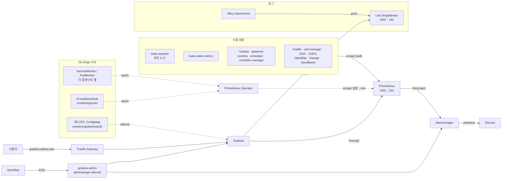
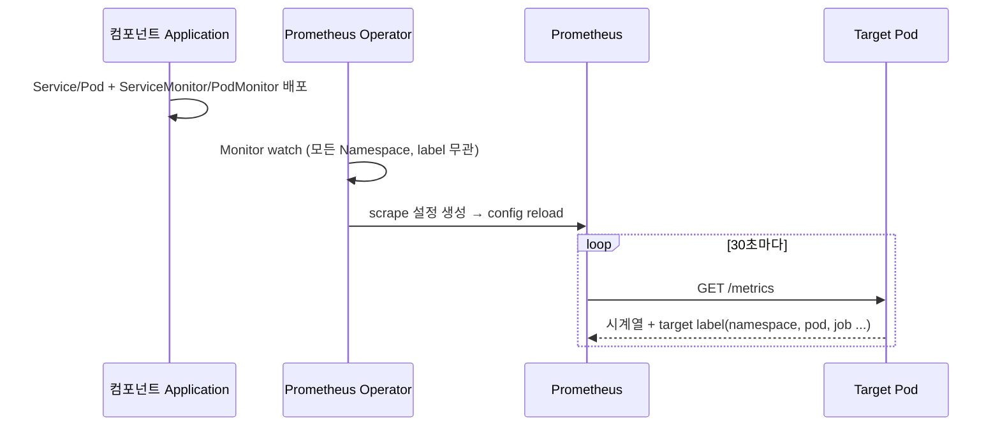
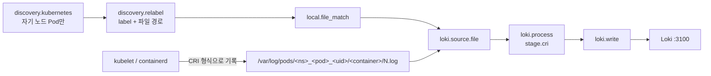
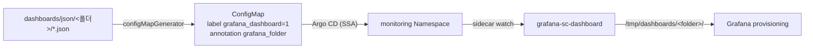
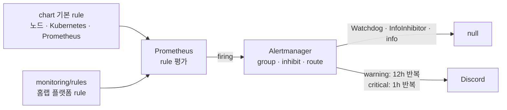
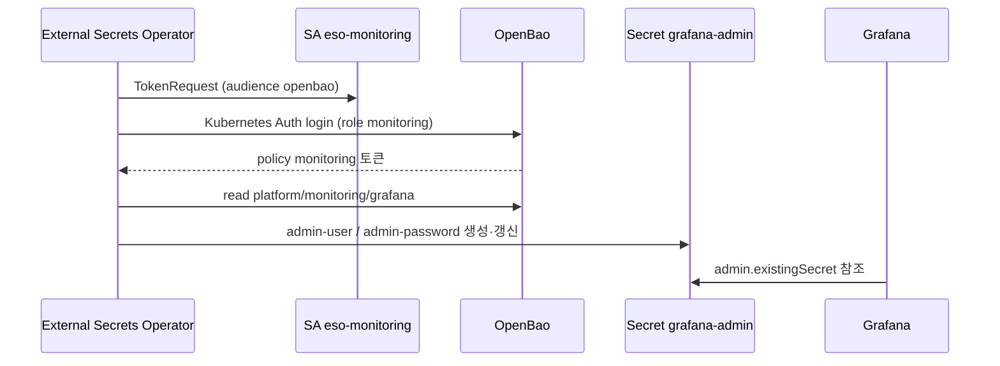

# Observability 구성

홈랩 클러스터의 metric, 로그, 알림, 대시보드 구성을 정리한다. 각 구성 요소가 어떻게 동작하는지,
이 환경에서 왜 이렇게 구성했는지, 배포 중 만난 문제를 함께 기록해 이후 운영과 글 작성의 근거로 쓴다.
배포 선언은 `gitops/platform/monitoring/`, 운영 절차는 같은 경로의 README를 기준으로 한다.

## 구성 의도

| 원칙 | 구성에 드러나는 방식 |
| --- | --- |
| 모든 설정은 Git에서 온다 | chart, scrape 대상, alert rule, Grafana 대시보드까지 Argo CD Application으로 배포한다. UI에서 바꾼 대시보드도 JSON으로 export해 Git에 반영해야 유지된다. |
| 수집 설정은 대상 옆에 둔다 | ServiceMonitor/PodMonitor는 각 컴포넌트의 chart values나 kustomization에 둔다. Prometheus는 label과 관계없이 모든 Monitor를 고르므로 monitoring 쪽 설정은 바꾸지 않는다. |
| 값은 Git에 남기지 않는다 | Grafana admin 계정과 Discord webhook은 OpenBao에 두고 ESO가 Secret으로 동기화한다. 렌더된 설정에도 값이 나오지 않게 파일 mount로 읽는다. |
| 공개 경로와 metric 경로를 분리한다 | 외부 route가 가리키는 포트와 metric 포트를 나눈다. 인증 없는 `/metrics`는 클러스터 내부 Service에서만 열린다. |
| 홈랩 규모에 맞게 최소로 | 단일 replica, `local-path` PVC, Loki SingleBinary를 쓴다. 고가용성보다 구성 요소 수와 관리할 Secret을 줄이는 쪽을 택했다. |
| 알림은 한 경로로 | Prometheus rule만 Alertmanager를 거쳐 Discord로 보낸다. Grafana-managed alert는 쓰지 않는다. |

## 한눈에 보기



| 구분 | 동작 | 저장소 | 조회 |
| --- | --- | --- | --- |
| Metric | Prometheus가 각 target의 `/metrics`를 주기적으로 pull(scrape) | Prometheus TSDB | Grafana(PromQL) |
| Log | Alloy가 노드의 Pod 로그 파일을 읽어 Loki로 push | Loki(filesystem) | Grafana(LogQL) |
| Alert | Prometheus가 rule을 평가하고 firing alert를 Alertmanager로 보냄 | Alertmanager | Discord |
| Dashboard | Grafana sidecar가 label이 붙은 ConfigMap을 읽어 등록 | Git(JSON) | Grafana |

## 구성 요소

### Prometheus

시계열 metric 데이터베이스다. 대상의 `/metrics` endpoint를 주기적으로 가져와 label이 붙은 시계열로
저장하고 PromQL로 조회한다. alert rule도 Prometheus가 평가한다.

### Prometheus Operator와 kube-prometheus-stack

Prometheus Operator는 Prometheus 설정을 Kubernetes 리소스로 관리하게 해 준다. `ServiceMonitor`,
`PodMonitor`, `PrometheusRule` CRD를 만들면 operator가 이를 watch해 Prometheus scrape 설정과 rule
파일로 변환하고 reload한다. 새 서비스를 수집하려면 Prometheus 설정 파일을 고치는 대신 서비스 옆에
Monitor 하나를 두면 된다.

| CRD | 고르는 대상 | 쓰는 경우 |
| --- | --- | --- |
| ServiceMonitor | Service의 endpoint | metric 포트가 Service에 노출된 경우 |
| PodMonitor | Pod의 container 포트 | Service가 없거나 Pod마다 따로 수집하는 경우 |
| PrometheusRule | - | recording/alert rule |

kube-prometheus-stack은 operator, Prometheus, Alertmanager, Grafana, kube-state-metrics,
node-exporter와 Kubernetes 기본 대시보드·alert rule을 한 번에 설치하는 Helm chart다.

### node-exporter와 kube-state-metrics

| exporter | 관점 | 예 |
| --- | --- | --- |
| node-exporter | 노드 OS | CPU, memory, disk, network, filesystem 사용량 |
| kube-state-metrics | Kubernetes object 상태 | Deployment replica, Pod phase, restart 횟수, PVC 상태 |

node-exporter는 노드마다 하나씩 DaemonSet으로 뜨고, kube-state-metrics는 API server를 watch하는
Deployment 하나다. container 자원 사용량(cAdvisor)은 operator가 만든 kubelet Service로 수집한다.

### Alertmanager

Prometheus가 보낸 alert를 묶고(group), 중복을 없애고, 억제(inhibit)한 뒤 receiver로 전달한다.
silence와 전송 기록을 자체 저장소에 둔다.

### Grafana

metric과 로그를 시각화하는 UI다. Prometheus와 Loki를 데이터소스로 연결한다. sidecar container가
`grafana_dashboard: "1"` label이 붙은 ConfigMap을 watch해 대시보드로 등록한다.

### Loki

로그 저장소다. 로그 본문은 색인하지 않고 `namespace`, `pod` 같은 label만 색인하며 본문은 압축
chunk로 저장한다. 저장 비용이 작고 Prometheus와 같은 label 모델이라 metric과 로그를 같은 기준으로
오갈 수 있다. 조회 언어는 LogQL이다.

| 모드 | 구조 | 용도 |
| --- | --- | --- |
| SingleBinary | 모든 기능이 Pod 하나 | 소규모, filesystem 저장 |
| SimpleScalable | read/write/backend 3그룹 | 중간 규모, object storage 필요 |
| Distributed | 기능별 microservice | 대규모 |

### Alloy

Grafana의 telemetry 수집 agent다. Promtail(유지보수 종료)과 Grafana Agent의 후속이며 metric·로그·
trace를 하나의 agent로 수집할 수 있다. component를 block으로 선언하고 출력을 서로 연결하는 Alloy
configuration syntax로 설정한다. 이 환경에서는 로그 수집만 맡긴다.

## 배포 단위와 순서

모든 리소스는 Argo CD root-app(App-of-Apps)의 Application이다. 외부 Helm chart는 chart와 Git의
values 파일을 묶은 multi-source Application이고, chart 버전은 root-app `platformVersions`에서 관리한다.

| wave | Application | 종류 | 경로 | 내용 |
| ---: | --- | --- | --- | --- |
| -50 | `namespaces` | Helm(내부) | `platform/namespaces` | `monitoring` Namespace |
| -8 | `platform-monitoring-secrets` | Kustomize | `monitoring/external-secrets` | SA, SecretStore, ExternalSecret(Grafana admin, Discord webhook) |
| -7 | `platform-kube-prometheus-stack` | Helm 92.14.0 | `monitoring/values.yaml` | CRD, operator, Prometheus, Alertmanager, Grafana, exporter |
| -6 | `platform-grafana-route` | Kustomize | `monitoring/exposure` | Grafana HTTPRoute |
| -6 | `platform-loki` | Helm 7.5.0 (Loki 3.6.16) | `monitoring/loki/values.yaml` | Loki StatefulSet |
| -5 | `platform-alloy` | Helm 1.14.3 (Alloy 1.21.2) | `monitoring/alloy/values.yaml` | Alloy DaemonSet |
| -4 | `platform-monitoring-rules` | Kustomize | `monitoring/rules` | 홈랩 PrometheusRule |
| -4 | `platform-grafana-dashboards` | Kustomize | `monitoring/dashboards` | 대시보드 ConfigMap |

순서에는 의존 관계가 담겨 있다.

- Secret이 먼저 있어야 Grafana와 Alertmanager가 기동한다(-8 → -7).
- Loki·Alloy·rule은 kube-prometheus-stack이 설치한 CRD(ServiceMonitor, PrometheusRule)를 쓴다(-7 → -6 이후).
- 대시보드는 Grafana와 데이터소스가 준비된 뒤에 등록한다(-4).

Namespace는 `namespaces` Application이 소유하고, monitoring Application은 Namespace를 직접 만들지
않는 `platform-existing-namespace` sync 정책(ServerSideApply 포함)을 쓴다. `monitoring` Namespace는
외부 route를 받기 때문에 `gatewayAccess: public` label을 갖는다. 공용 Gateway는 이 label이 있는
Namespace의 HTTPRoute만 허용한다.

## 노드 배치

클러스터는 control plane 1대와 prod/dev Worker 각 1대이고, Worker에는
`homelab.okbear.dev/environment=prod|dev:NoSchedule` taint가 걸려 있다.

| 구성 요소 | 배치 | 이유 |
| --- | --- | --- |
| Prometheus, Alertmanager, operator, kube-state-metrics | prod Worker 고정 | 다른 플랫폼 구성 요소와 같은 안정 노드 |
| Loki | prod Worker 고정 | 로그 PVC를 안정 노드에 둔다 |
| Grafana | prod/dev taint 모두 허용 | UI는 어느 Worker에 떠도 무방하다 |
| node-exporter, Alloy | 모든 노드 | 노드 단위 수집이라 control plane까지 포함한다 |

Grafana는 nodeSelector 없이 두 taint를 모두 허용한다. 다만 `local-path` PV는 처음 생성된 노드에
묶이므로, 최초 배치 이후에는 그 노드에서만 다시 뜬다.

## Metric 수집

### 동작 방식



Prometheus는 chart release label이 없는 ServiceMonitor, PodMonitor, PrometheusRule도 고른다
(`*SelectorNilUsesHelmValues: false`). 그래서 각 컴포넌트는 monitoring 쪽에 아무것도 등록하지 않고
자기 Application 안에 Monitor만 두면 된다. 컴포넌트를 지우면 그 Monitor도 같이 사라져 수집 설정이
따로 남지 않는다.

저장은 `local-path` 20Gi PVC이고 보존 기간은 15일 또는 18GB 중 먼저 닿는 쪽이다.

### 수집 대상

| 대상 | 리소스 | 선언 위치 | endpoint |
| --- | --- | --- | --- |
| 노드, Kubernetes | chart 기본 ServiceMonitor | `monitoring/values.yaml` | node-exporter, kube-state-metrics, kubelet/cAdvisor, apiserver, coredns, scheduler, controller-manager |
| Prometheus 스택 자체 | chart 기본 ServiceMonitor | `monitoring/values.yaml` | Prometheus, Alertmanager, operator, Grafana |
| Loki, Alloy | chart ServiceMonitor | `monitoring/loki`, `monitoring/alloy` | 각 chart 기본 포트 |
| Traefik | metrics Service + ServiceMonitor | `platform/traefik/values.yaml` | entrypoint·service별 요청 수, 지연, 응답 코드 |
| cert-manager | ServiceMonitor (`honorLabels`) | `platform/cert-manager/values.yaml` | 인증서 만료·Ready 상태 |
| External Secrets | ServiceMonitor (`honorLabels`) | `platform/external-secrets/values.yaml` | ExternalSecret 동기화 상태 |
| CNPG operator | PodMonitor | `platform/cloudnative-pg/values.yaml` | operator 상태 |
| PostgreSQL Cluster | PodMonitor `postgres` | `databases/postgres/base/podmonitor.yaml` | `metrics` 포트(9187) |
| OpenBao | chart ServiceMonitor | `platform/openbao/values.yaml` | 내부 전용 listener `:8210` `/v1/sys/metrics` |
| Garage | ServiceMonitor `garage` | `platform/garage/servicemonitor.yaml` | admin 포트 `:3903` `/metrics` |
| cloudflared | PodMonitor | `platform/cloudflared/podmonitor.yaml` | Pod `:2000` `/metrics` |

### 대상별 결정

**OpenBao: 공개 listener와 metric listener 분리**

`openbao.okbear.dev` HTTPRoute는 `:8200`의 `/` 전체를 공개한다. 이 listener에서 인증 없는 metric
접근을 켜면 `/v1/sys/metrics`가 인터넷에 노출된다. 그래서 `telemetry { unauthenticated_metrics_access
= true }`를 둔 두 번째 listener `:8210`을 열고, chart Service의 extra port로만 노출했다. 이 listener에서도
metric 외 API는 token이 필요하다. 차트가 `8202`를 replication 포트로 쓰기 때문에 `8210`을 골랐다.

chart ServiceMonitor는 HA 모드에서 `platform-openbao-active` Service만 고른다. sealed 상태에서는
active Pod가 없어 target과 `vault_core_unsealed`가 함께 사라진다. 이 동작은 알림 rule에서 보완한다
([알림](#알림) 참고). OpenBao StatefulSet은 `updateStrategyType: OnDelete`라 설정을 반영하려면 Pod를
직접 지우고 수동으로 unseal해야 한다.

**Garage: token 없는 내부 수집**

Garage는 `metrics_token`이 없으면 `/metrics`를 인증 없이 연다. 이 포트(`:3903`)는 클러스터 내부
Service에만 있고 외부에는 S3 website 포트만 proxy를 거쳐 나가므로 token을 두지 않았다. token을 쓰면
OpenBao 값, ExternalSecret, Secret 참조가 하나씩 늘어나는데 막는 경로가 없다. init script는 기동할
때마다 기존 PVC의 `garage.toml`에서 `metrics_token` 줄을 지워, 예전에 생성된 token이 남아 있어도
같은 상태로 맞춘다.

Garage Deployment와 Service selector는 `app.kubernetes.io/component: server`로 web-proxy Pod와 구분했다.
같은 `app.kubernetes.io/name`만 쓰면 ServiceMonitor가 proxy Pod까지 target으로 잡는다.

**cloudflared**

cloudflared는 이미 `--metrics 0.0.0.0:2000`으로 metric을 열고 있고 Service가 없어 PodMonitor로
수집한다. replica 2개가 각각 Cloudflare edge와 연결 4개를 맺으므로 정상 상태의
`cloudflared_tunnel_ha_connections` 합은 8이다.

**cert-manager, ESO: `honorLabels`**

두 exporter는 대상 리소스(Certificate, ExternalSecret)의 namespace를 `namespace` label로 내보낸다.
Prometheus는 기본적으로 target의 `namespace`(`cert-manager`, `external-secrets`)를 우선하고 원래 값을
`exported_namespace`로 밀어낸다. 그러면 alert의 `namespace`와 Alertmanager의 `group_by`가 실제
리소스 위치와 달라지므로 두 ServiceMonitor에 `honorLabels: true`를 두었다.

**수집하지 않는 대상**

Kubespray 기본 구성에서 수집할 수 없는 target은 비활성화했다. 켜 두면 target이 항상 down이어서
경고만 늘어난다.

- etcd는 host systemd 서비스이고 metrics endpoint가 mTLS client 인증서를 요구한다.
- kube-proxy metrics는 `127.0.0.1:10249`에만 bind된다.

controller-manager와 scheduler는 켜 두었다. bind 주소에 따라 down일 수 있어 sync 후 Targets 화면에서
확인한다.

**애플리케이션 metric**

앱 자체 metric은 아직 없다. Traefik metric으로 모든 앱의 요청 수·오류율·지연(RED)을 코드 수정 없이
보고, 런타임 지표는 앱이 노출하면 추가한다.

- Spring Boot: Actuator와 `micrometer-registry-prometheus`를 추가하고 관리 포트를 업무 포트와 분리한 뒤
  ServiceMonitor를 앱 base에 둔다.
- Jira Data Center: Helm `monitoring.exposeJmxMetrics`, `monitoring.serviceMonitor.create`를 켠다.

## 로그 수집



- Alloy는 DaemonSet이고 각 Pod는 `spec.nodeName=$HOSTNAME` selector로 **자기 노드의 Pod만** 찾는다.
  노드마다 Alloy가 있으므로 같은 로그를 중복 수집하지 않고, API server 부하도 노드 단위로 나뉜다.
- Pod metadata로 `namespace`, `pod`, `container`, `app`, `node` label을 붙이고, Pod UID와 container
  이름으로 `/var/log/pods` 아래 로그 파일 경로를 만든다. host의 `/var/log`를 읽기 위해 chart의
  `mounts.varlog`를 켰다.
- `stage.cri`가 containerd 로그 형식(`timestamp stream flag message`)을 풀어 원래 로그 줄과 timestamp를
  복원한다.
- label은 Pod metadata만 쓴다. 로그 level처럼 값의 종류가 적은 것만 label로 추가할 수 있고, request
  id처럼 값이 계속 늘어나는 것은 label로 쓰지 않는다. Loki는 label 조합마다 stream을 만들기 때문이다.
- 전송 대상은 클러스터 내부 Service `platform-loki.monitoring:3100`이다.

Loki는 SingleBinary 1개 Pod로 운영한다.

| 설정 | 값 | 이유 |
| --- | --- | --- |
| 저장소 | `local-path` 30Gi PVC, filesystem | Prometheus와 같은 내구성 수준, 추가 Secret 불필요 |
| 보존 | 14일, compactor retention | 디스크 사용량 상한 |
| 인증 | `auth_enabled: false` | 단일 테넌트, 클러스터 내부 전용 |
| schema | TSDB index, v13 | 현재 권장 schema |
| PVC 정책 | `whenDeleted/whenScaled: Retain` | Application 삭제나 replica 조정으로 로그를 잃지 않는다 |
| 비활성 | memcached cache, nginx gateway, canary/test | 단일 Pod 규모에는 불필요 |

Garage S3를 object storage로 쓰는 방식도 검토했다. Garage 역시 single-node `local-path` 위에 있어
실제 내구성 차이가 작고, bucket과 access key를 OpenBao/ESO로 추가 관리해야 해서 filesystem을 선택했다.

## 대시보드

### 동작 방식



- `monitoring/dashboards/kustomization.yaml`이 폴더별 JSON을 ConfigMap으로 만든다. 이름 hash suffix를
  끄고(`disableNameSuffixHash`) ConfigMap 이름을 고정해, JSON을 고쳐도 같은 ConfigMap이 갱신된다.
- Grafana sidecar는 `grafana_dashboard: "1"` label을 찾고, `folderAnnotation: grafana_folder` 설정에 따라
  annotation 값의 하위 디렉터리에 파일을 둔다. `foldersFromFilesStructure: true`가 이 디렉터리를
  Grafana 폴더로 만든다.
- ConfigMap 하나가 수십 KiB라 client-side apply의 last-applied annotation 한도에 걸릴 수 있다.
  Application은 ServerSideApply로 적용한다.

### 구성

인프라 → 클러스터 → 애플리케이션 계층으로 나누고, Overview에서 아래 계층으로 내려가는 구조다.

| Grafana 폴더 | 대시보드 | 데이터 | 보는 시점 |
| --- | --- | --- | --- |
| 00 Overview | Homelab Overview | 전 계층 요약 | 매일 첫 화면, 알림을 받았을 때 |
| 01 Infrastructure | 인프라 · 노드 | node-exporter | 노드 자원이 의심될 때 |
| 02 Cluster | Kubernetes / 플랫폼 서비스 / Ingress · Edge | kube-state-metrics, cAdvisor, OpenBao, Garage, CNPG, ESO, Traefik, cloudflared, cert-manager | Pod 장애, Secret·스토리지·DB, 외부 접속 문제 |
| 03 Application | 애플리케이션 | Traefik RED, cAdvisor, 앱 지표, Loki | 서비스 하나를 깊게 볼 때 |
| (chart 기본) | kube-prometheus-stack 기본 대시보드 | - | 세부 참고용 |

- 모든 대시보드는 **요약(Stat) → 추세(Time series) → 상세(Table) → 로그** 순서로 배치한다.
- Overview의 패널을 클릭하면 Data link로 해당 상세 대시보드로 이동한다. 링크가 uid를 참조하므로
  대시보드 uid는 바꾸지 않는다.
- 데이터소스는 변수(`datasource`, `loki`)로 받는다. 수집되지 않는 지표는 "No data" 대신 `수집 안 됨`으로
  표시해 설정 누락과 정상 0을 구분한다.
- local-path PVC는 모두 노드 루트 디스크에 있어 `kubelet_volume_stats_*`가 나오지 않는다. 그래서 PVC
  실사용량 대신 노드 루트 디스크 사용률과 "24시간 뒤 예상 여유 공간"으로 Prometheus/Loki/OpenBao/
  Garage/PostgreSQL 저장 공간을 본다.

### 관리 방식: Git이 원본, UI는 실험용

| | Git(JSON + sidecar) | Grafana UI |
| --- | --- | --- |
| 저장 위치 | Git → ConfigMap | Grafana DB(`grafana.db`, local-path PVC) |
| 재현성 | 클러스터를 다시 만들어도 같은 화면 | PVC가 사라지면 함께 사라짐(백업 없음) |
| 변경 이력 | commit/PR, 되돌리기 쉬움 | Grafana version history(DB 안) |
| 수정 속도 | export → commit → sync | 즉시 저장 |
| uid 참조 | Data link, alert annotation과 함께 관리 | uid가 바뀌면 링크가 조용히 깨짐 |

계속 쓰는 대시보드는 Git에 두고, 장애 분석이나 패널 실험은 UI의 `Sandbox` 폴더에서 한다. 쓸 만해진
대시보드만 JSON으로 export해 `json/<폴더>/`에 넣는다. kube-prometheus-stack sidecar provider는
`allowUiUpdates: false`라 Git에서 온 대시보드는 UI에서 저장되지 않는다. UI 변경이 Git 내용과 섞이지
않도록 이 설정을 유지한다.

Grafonnet/Jsonnet, Grafana Operator, Terraform provider도 검토했다. 대시보드 6개를 혼자 관리하는
규모에서는 학습·구성 비용이 더 크고, 앱별 대시보드는 `namespace` 변수 하나로 해결되어 raw JSON을
유지한다. export마다 바뀌는 `id`, `version`, `iteration`을 지워 diff를 줄인다. 앱이 늘어 같은 모양의
대시보드를 반복해서 만들게 되면 코드 생성 방식을 다시 검토한다. 절차는
[dashboards README](../../gitops/platform/monitoring/dashboards/README.md)를 따른다.

## 알림

### 흐름



### rule

노드, Kubernetes, Prometheus 자체 알림(`NodeFilesystemSpaceFillingUp`, `KubePodCrashLooping`,
`TargetDown` 등)은 chart 기본 rule을 쓴다. etcd와 kube-proxy rule은 수집을 끈 만큼 같이 껐다.
기본 rule이 모르는 홈랩 플랫폼 구성 요소는 `monitoring/rules/homelab-platform-rules.yaml`에 둔다.

| group | alert | 의도 |
| --- | --- | --- |
| openbao | `OpenBaoSealed` (critical) | sealed면 모든 ExternalSecret 동기화가 멈춘다 |
| garage | `GarageClusterUnhealthy`, `GarageErroredBlocks` (critical), `GarageDiskAlmostFull`, `GarageMetricsMissing` | 이미지 저장소 상태와 데이터 유실 징후 |
| edge | `CloudflaredTunnelDown` (critical), `CloudflaredTunnelDegraded`, `TraefikServiceHigh5xx` | 외부 접속 경로 전체와 서비스별 오류율 |
| edge | `CertificateExpiringCritical` (critical), `CertificateExpiringSoon`, `CertificateNotReady` | cert-manager 갱신 실패를 만료 전에 발견 |
| secrets-and-data | `ExternalSecretSyncFailed`, `PostgresInstanceDown` (critical), `PostgresConnectionsHigh` | Secret 동기화와 DB 가용성 |

rule을 만들 때의 기준은 다음과 같다.

- **수집이 안 되는 것도 장애로 본다.** OpenBao ServiceMonitor는 sealed 상태에서 target이 사라지므로
  `OpenBaoSealed`는 `(max(vault_core_unsealed) == 0) or absent(vault_core_unsealed)`로 지표가 없을 때도
  firing한다. cloudflared도 `or vector(0)`으로 Pod가 모두 사라진 경우를 잡는다.
- **알림 하나로 원인을 좁힐 수 있게 한다.** description에 확인할 명령이나 리소스를 적고, 관련 대시보드
  링크를 `dashboard` annotation으로 붙인다.
- **cert-manager가 스스로 고칠 시간은 기다린다.** 인증서는 만료 30일 전부터 자동 갱신되므로 14일
  전부터 알린다. 이 알림이 뜨면 갱신이 실패하고 있다는 뜻이다.

### 라우팅

- alert를 `namespace`, `alertname`으로 묶어 Discord로 보낸다. critical은 1시간, 나머지는 12시간마다 다시 알린다.
- `Watchdog`, `InfoInhibitor`, `severity=info`는 `null` receiver로 보낸다. 항상 울리거나 참고용이라
  채널을 소음으로 채우기 때문이다.
- chart 기본 inhibit rule(같은 alert의 critical이 warning/info를 억제)은 그대로 쓴다.
- Discord webhook URL은 OpenBao `secret/platform/monitoring/alertmanager`에 두고 ESO가
  `alertmanager-discord` Secret으로 동기화한다. Alertmanager는 이 Secret을 파일로 mount해
  `webhook_url_file`로 읽으므로 URL이 Git이나 렌더된 설정에 남지 않는다.
- Alertmanager도 prod Worker에서 돌기 때문에 그 노드가 죽으면 알림도 멈춘다. silence와 전송 기록은
  `local-path` 2Gi PVC에 둔다.

## Grafana 접근과 Secret

- `grafana.okbear.dev` HTTPRoute가 공용 `public-gateway`의 http/https listener에 붙는다. TLS는
  Gateway의 `*.okbear.dev` wildcard 인증서가 종료한다.
- 익명 접근과 회원 가입은 끄고, admin 계정 하나로 로그인한다.
- admin 계정은 OpenBao KV v2 `secret/platform/monitoring/grafana`에 저장하고 ESO가 `grafana-admin`
  Secret으로 동기화한다.



이 흐름은 api-common dev 앱의 OpenBao + ESO 전환과 같은 구조다. ServiceAccount(wave -3),
SecretStore(-2), ExternalSecret(-1) 순서로 적용하고, SA token은 Pod에 mount하지 않는다. Grafana는
admin 값을 최초 DB 생성 시에만 반영하므로, PVC가 이미 있는 상태에서 값을 바꾸면
`grafana cli admin reset-admin-password`로 맞춘다.

| 데이터소스 | uid | 주소 |
| --- | --- | --- |
| Prometheus | `prometheus` | chart 기본값(`kube-prometheus-stack-prometheus`) |
| Loki | `loki` | `http://platform-loki.monitoring:3100` |

## 배포 중 만난 문제와 결정

### Helm release 이름 잘림

Argo CD는 Application 이름을 Helm release 이름으로 쓰므로 release는
`platform-kube-prometheus-stack`(30자)이 된다. kube-prometheus-stack은 리소스 이름을 26자로 자르기
때문에 `platform-kube-prometheus-s` 같은 이름이 생긴다. `fullnameOverride: kube-prometheus-stack`으로
고정했다. Grafana, kube-state-metrics 같은 subchart는 자기 규칙을 따르므로
`platform-kube-prometheus-stack-grafana`처럼 release 이름이 그대로 붙는다.

### `kube-system` destination

chart가 coredns, controller-manager, scheduler scrape용 Service를 `kube-system`에 만든다. platform
AppProject의 destination에 `kube-system`이 없으면 sync가 거부되므로 추가했다.

### `namespaces "monitoring" not found`

첫 배포에서 monitoring Application이 모두 이 오류로 실패했다. sync wave는 Application을 만드는 순서일
뿐이고, 앞 wave의 `namespaces` Application이 새 commit을 반영해 Namespace를 만들었다는 보장은 아니다.
`namespaces`가 sync된 뒤 monitoring Application을 다시 sync해 해결했다. 자동 sync는 같은 revision의
재시도 횟수를 다 쓰면 다시 시도하지 않으므로 수동 sync가 필요할 수 있다.

### OpenBao metric 포트 충돌

처음에는 metric listener를 `8202`에 두려 했으나 chart가 이 포트를 HA replication(`http-rep`)으로 이미
쓰고 있어 `8210`으로 옮겼다.

### 수집 설정 중복

대시보드 작업 중 OpenBao, Garage, cloudflared 수집을 `monitoring/integrations/`에 따로 모은 초안이
있었다. 같은 시점에 각 컴포넌트 옆에 Monitor를 둔 변경이 들어와, 저장소 관례(수집 설정은 대상 옆)에
맞춰 초안의 수집 리소스는 지우고 alert rule만 `monitoring/rules/`로 옮겼다. 두 방식이 모두 배포되면
같은 지표가 job 두 개로 수집되어 `sum()` 결과가 두 배가 된다. 한 대상의 Monitor는 한 곳에만 둔다.

### ESO ServiceMonitor 렌더 조건

ESO chart는 `monitoring.coreos.com/v1/ServiceMonitor` API가 Capabilities에 있을 때만 ServiceMonitor를
렌더한다. 로컬 `helm template`에서는 보이지 않지만 CRD가 설치된 클러스터에서는 생성된다. 새 클러스터
bootstrap에서는 kube-prometheus-stack(wave -7)보다 앞 wave인 컴포넌트의 Monitor가 CRD 설치 전까지 sync
실패 후 재시도할 수 있다.

### AppProject 삭제 표시

진단 중 `platform`, `apps-dev`, `apps-prod` AppProject에 2026-08-02부터 deletionTimestamp가 붙어 있는
것을 발견했다. 이 프로젝트를 쓰는 Application이 남아 있어 finalizer가 실제 삭제를 막고 있고, 당장
서비스에는 영향이 없다. monitoring 구성과는 별개 문제로 따로 정리한다.

### CI 평문 Secret 검사

`gitops-validate.yml`은 `^kind: Secret` 패턴으로 평문 Secret을 찾는데 `kind: SecretStore`도 이 패턴에
걸렸다. 패턴 끝을 고정해 해결했다. 상세는 [GitOps 검증](validation.md)을 참고한다.

## 검증

```bash
kubectl -n monitoring get pod,pvc
kubectl -n monitoring wait --for=condition=Ready externalsecret/grafana-admin --timeout=120s
kubectl -n monitoring wait --for=condition=Ready externalsecret/alertmanager-discord --timeout=120s
kubectl -n monitoring get prometheus,alertmanager,prometheusrule
kubectl get servicemonitor,podmonitor -A
kubectl -n monitoring get configmap -l grafana_dashboard=1
kubectl -n monitoring rollout status daemonset/platform-alloy
kubectl -n monitoring port-forward svc/kube-prometheus-stack-prometheus 9090
```

- Prometheus Status → Targets에서 down target이 없는지, Status → Rules에서 `homelab.*` group이
  로드됐는지 본다.
- `certmanager_certificate_expiration_timestamp_seconds`의 `namespace` label이 Certificate가 있는
  Namespace로 나오는지 본다(`honorLabels` 확인).
- Alertmanager UI(`svc/kube-prometheus-stack-alertmanager` 9093)에서 Watchdog 외 firing alert와 Discord
  전송 오류가 없는지 본다.
- `https://grafana.okbear.dev`에서 로그인하고 `00 Overview` ~ `03 Application` 폴더가 생겼는지 본다.
- Grafana Explore에서 Loki를 선택하고 `{namespace="api-common-dev"}`로 로그가 들어오는지 본다.

## 한계와 후속 작업

- Watchdog을 외부 dead man's switch(healthchecks.io 등)로 보내지 않아, prod Worker나 Alertmanager가
  죽으면 알림이 오지 않는다는 사실도 알 수 없다.
- Prometheus, Loki, Grafana 모두 `local-path` PVC라 노드 디스크가 사라지면 데이터도 사라진다. 장기 보존이나
  원격 백업은 없다.
- 수집하지 않는 영역
  - etcd와 kube-proxy: Kubespray 변수로 bind 주소를 바꾸거나 etcd client 인증서를 Secret으로 넣어야 한다.
  - Argo CD: ansible로 설치한 chart values에 metrics/ServiceMonitor 설정이 없다.
  - Proxmox 호스트: VM 내부만 node-exporter로 보고, 하이퍼바이저와 스토리지는 보지 않는다.
  - 애플리케이션 런타임 지표(JVM 등)와 trace.
- 로그
  - level label이 없어 WARN 이상만 고르려면 본문 검색(`|~ "ERROR"`)에 의존한다.
  - Loki ruler를 Alertmanager에 연결하지 않아 로그 기반 알림이 없다.
  - Kubernetes 이벤트는 수집하지 않는다.
  - Alloy는 읽은 위치(positions)를 컨테이너 내부 `/tmp/alloy`에 두므로 Pod가 재시작되면 일부 로그를 다시 보낼 수 있다.
- Grafana는 admin 계정 하나만 쓰고 공개 route로 노출된다. SSO나 Cloudflare Access 같은 접근 제한은 후속 범위다.
