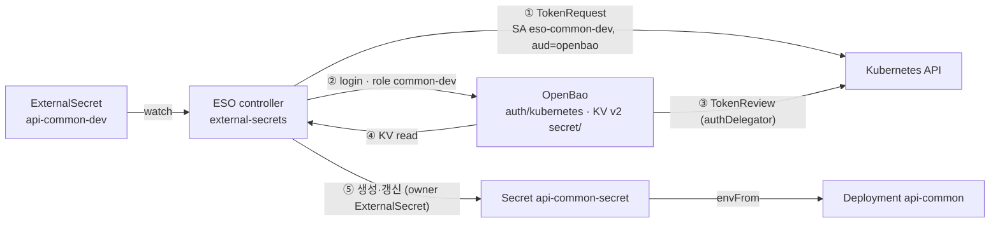

# OpenBao + ESO 구성과 트러블슈팅

api-common dev의 앱 Secret `api-common-secret`은 OpenBao + External Secrets Operator(ESO)로
동기화한다. SecretStore와 ExternalSecret 모두 Ready이며 키 5개가 ESO 소유로 생성된 것을
확인했다.

| 항목 | 상태 |
| --- | --- |
| 대상 | `api-common-dev` 네임스페이스의 `api-common-secret` |
| 이전 방식 | KSOPS `secret-generator.yaml` + `secret.sops.env` (삭제 완료) |
| 계속 SOPS 사용 | GHCR pull Secret(`base/ghcr-secret*`), CNPG DB 계정 Secret |
| prod | overlay 작성 중, root-app 미등록, OpenBao role 미생성 |

## 인증·동기화 흐름



ESO는 앱 SA의 단기 토큰으로 OpenBao에 로그인하고, OpenBao는 TokenReview로 그 토큰을
검증한다. 발급된 OpenBao 토큰은 `common-dev` policy로 `apps/common/dev/*`만 읽을 수 있다.

## GitOps 리소스

플랫폼(OpenBao, ESO)은 `platform` 프로젝트가, 앱별 인증 리소스는 각 앱 overlay의
`external-secrets/`가 관리한다.

| 리소스 | 경로 | 핵심 설정 |
| --- | --- | --- |
| OpenBao (Helm 0.29.2, 2.6.2) | `gitops/platform/openbao/values.yaml` | Raft 1 replica, `tlsDisable: true`, injector/CSI 꺼짐, `authDelegator.enabled: true`, wave -13 |
| OpenBao HTTPRoute | `gitops/platform/openbao/exposure/httproute.yaml` | `openbao.okbear.dev` → `platform-openbao-ui:8200`, http·https 리스너 모두 연결 |
| ESO (Helm 2.9.0) | `gitops/platform/external-secrets/values.yaml` | namespace 범위 SecretStore만 처리, ClusterSecretStore·PushSecret 비활성, wave -12 |
| ServiceAccount `eso-common-dev` | `gitops/apps/api-common/overlays/dev/external-secrets/serviceaccount.yaml` | `automountServiceAccountToken: false`, wave -3 |
| SecretStore `openbao-common-dev` | `.../external-secrets/secretstore.yaml` | KV v2 `secret`, auth `kubernetes`, role `common-dev`, audiences `openbao`, wave -2 |
| ExternalSecret `api-common-secret` | `.../external-secrets/externalsecret.yaml` | refresh 1h, `creationPolicy: Owner`, wave -1 |
| AppProject `apps-dev` | `gitops/clusters/homelab/argocd-control-plane/projects/apps-dev.yaml` | SA, SecretStore, ExternalSecret 허용, 클러스터 범위 리소스 금지 |

ExternalSecret 키 매핑(엔진 `secret`, KV v2):

| Secret 키 | OpenBao 경로 | property |
| --- | --- | --- |
| DB_USERNAME | `apps/common/dev/database` | `username` |
| DB_PASSWORD | `apps/common/dev/database` | `password` |
| JWT_SECRET | `apps/common/dev/auth` | `jwt-secret` |
| GARAGE_ACCESS_KEY | `apps/common/dev/image` | `garage-access-key` |
| GARAGE_SECRET_KEY | `apps/common/dev/image` | `garage-secret-key` |

ESO 컨트롤러 SA는 `external-secrets/platform-external-secrets`이다. chart의 ClusterRole이
`serviceaccounts/token` create 권한을 주므로 별도 RBAC는 필요 없다.

## OpenBao 설정 절차

OpenBao 내부 설정은 GitOps로 관리하지 않는다. 새 환경(prod)을 만들 때는 아래 순서를 따른다.
명령은 `platform-openbao-0` Pod 안에서 관리자 토큰으로 로그인한 상태에서 실행한다.

1. KV v2 엔진과 Kubernetes Auth를 켠다. 이미 켜져 있으면 건너뛴다(`bao secrets list`,
   `bao auth list`로 확인).

```bash
bao secrets enable -path=secret kv-v2
bao auth enable kubernetes
```

2. Kubernetes Auth를 설정한다. 주소에 꺾쇠괄호를 넣지 않는다. 로컬 Pod 토큰으로 TokenReview를
   호출하며, 권한은 chart의 authDelegator 바인딩이 준다.

```bash
bao write auth/kubernetes/config \
  kubernetes_host='https://kubernetes.default.svc:443' \
  token_reviewer_jwt='' \
  disable_local_ca_jwt=false
```

3. 시크릿을 저장한다. ExternalSecret이 요구하는 경로와 property가 하나라도 없으면 전체 동기화가
   실패한다.

```bash
bao kv put -mount=secret apps/common/dev/database username='...' password='...'
bao kv put -mount=secret apps/common/dev/auth jwt-secret='...'
bao kv put -mount=secret apps/common/dev/image garage-access-key='...' garage-secret-key='...'
```

4. 읽기 전용 policy를 만든다.

```bash
bao policy write common-dev - <<'EOF'
path "secret/data/apps/common/dev/*" {
  capabilities = ["read"]
}
EOF
```

5. role을 만든다. SA 이름, 네임스페이스, audience가 SecretStore와 정확히 같아야 한다.

```bash
bao write auth/kubernetes/role/common-dev \
  bound_service_account_names=eso-common-dev \
  bound_service_account_namespaces=api-common-dev \
  audience=openbao \
  token_policies=common-dev \
  token_ttl=1h token_max_ttl=4h
```

prod는 `dev`를 `prod`로 바꿔 같은 순서로 만든다. role은 prod SA가 생긴 뒤 만들어도 된다.

## 검증

아래 순서대로 확인하면 어느 단계에서 막혔는지 바로 구분된다.

| 단계 | 명령 | 기대 결과 |
| --- | --- | --- |
| OpenBao TokenReview 권한 | `kubectl auth can-i create tokenreviews.authentication.k8s.io --as=system:serviceaccount:openbao:platform-openbao` | `yes` |
| ESO 토큰 발급 권한 | `kubectl auth can-i create serviceaccounts --subresource=token -n api-common-dev --as=system:serviceaccount:external-secrets:platform-external-secrets` | `yes` |
| role 설정 | `bao read auth/kubernetes/role/common-dev` | SA, namespace, `audience=openbao`, `token_policies=[common-dev]` |
| 인증 연결 | `kubectl -n api-common-dev wait --for=condition=Ready secretstore/openbao-common-dev --timeout=120s` | `condition met` |
| KV 읽기·동기화 | `kubectl -n api-common-dev wait --for=condition=Ready externalsecret/api-common-secret --timeout=120s` | `condition met` |
| Secret 키 | `kubectl -n api-common-dev get secret api-common-secret -o jsonpath='{.data}'` | 키 5개 |
| 소유자 | `kubectl -n api-common-dev get secret api-common-secret -o jsonpath='{.metadata.ownerReferences[0].kind}'` | `ExternalSecret` |

`envFrom`은 Pod 시작 때만 읽힌다. 값을 바꾼 뒤에는
`kubectl -n api-common-dev rollout restart deployment/api-common`을 실행한다.

## 트러블슈팅

대부분의 문제는 이름 불일치(namespace, 경로, property, audience)나 복사한 명령의 형식 오류였다.
먼저 `kubectl -n api-common-dev describe secretstore openbao-common-dev`와
`describe externalsecret api-common-secret`의 이벤트를 본다.

| 증상 | 원인 | 해결 |
| --- | --- | --- |
| SecretStore 이벤트에 403 / permission denied | role의 SA·namespace·audience가 SecretStore와 다름 | `bao read auth/kubernetes/role/<role>`로 `audience=openbao`, SA, namespace 확인 |
| SecretStore 이벤트에 connection/TokenReview 오류 | `kubernetes_host`에 마크다운 링크에서 복사된 꺾쇠괄호(`<https://...>`)가 들어감 | 꺾쇠괄호 없이 `https://kubernetes.default.svc:443`로 다시 write |
| `bao write auth/kubernetes/config`가 `no handler for route` | Kubernetes Auth가 활성화되지 않음 | `bao auth enable kubernetes` 후 재실행 |
| SecretStore는 Ready인데 ExternalSecret만 실패 | ExternalSecret이 요구하는 경로/property가 OpenBao에 없음 | `bao kv get -mount=secret <경로>`로 property 이름까지 대조. 하나라도 없으면 Secret 전체가 생성되지 않음 |
| property 이름 혼동 | README는 대문자 `GARAGE_ACCESS_KEY`, manifest는 `garage-access-key`로 서로 달랐음. dev는 `image`, prod는 `garage` 경로를 씀 | README를 manifest에 맞춤. prod 구성 전에 경로·키 이름 통일 필요 |
| TokenReview용 ClusterRoleBinding을 두 번 만듦 | 첫 명령의 subject가 `platform-openbao:platform-openbao`(실제 namespace는 `openbao`) | chart의 `authDelegator.enabled: true`가 같은 권한을 이미 줌. 수동 `openbao-tokenreview`는 삭제 대상 |
| `create_kubernetes_role: not found` | 함수를 정의한 셸을 나왔다가 새 셸에서 호출함 | role은 이미 생성돼 있었음. `bao read`로 확인 |
| `kubectl auth can-i create serviceaccounts/token`이 `no` | `kubectl auth can-i`가 `serviceaccounts/token`을 "이름이 token인 SA"로 해석함 | `--subresource=token`으로 확인하면 `yes` |
| 값을 바꿨는데 앱에 반영 안 됨 | `envFrom`은 Pod 시작 때만 읽힘. ESO는 Pod를 재시작하지 않음 | `rollout restart`. 필요하면 Reloader 도입 검토 |
| 해시가 붙은 `api-common-secret-xxxxx`가 남아 있음 | KSOPS가 만든 이전 Secret. Argo CD prune이 꺼져 있으면 남음 | Pod가 참조하지 않는지 확인 후 삭제 |
| dev overlay 전체 `kustomize build` 실패 | GHCR generator가 ksops를 쓰는데 로컬에 ksops가 없음 | `kustomize build .../external-secrets`만 로컬에서 검증 |

## 남은 작업

- [ ] 수동 ClusterRoleBinding `openbao-tokenreview` 삭제 (chart 바인딩과 중복)
- [ ] OpenBao HTTPRoute에서 `http` 리스너 제거 또는 https 리다이렉트 (현재 평문 접근 가능)
- [ ] dev/prod Garage 경로와 property 이름 통일
- [ ] SecretStore `server` 주소를 dev도 FQDN(`platform-openbao.openbao.svc.cluster.local`)으로 맞춤
- [ ] 해시 붙은 이전 KSOPS Secret 정리 확인
- [ ] prod: OpenBao 시크릿·policy·role(`common-prod`, `api-common-prod`, `eso-common-prod`) 생성
- [ ] prod: `api-common-prod` Application을 root-app에 등록하고 `apps-prod` AppProject 변경과 함께 반영
- [ ] OpenBao 운영: auto-unseal 없음(재시작 시 수동 unseal), audit device·snapshot agent 미설정
- [ ] (선택) GHCR pull Secret도 ESO `dockerconfigjson` 템플릿으로 전환 검토
