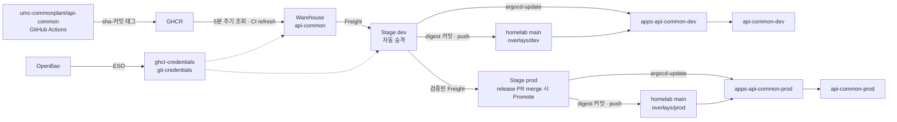

# Kargo 이미지 승격

CommonPlant 애플리케이션 이미지를 Kargo로 환경별 GitOps overlay에 승격하는 구성을 정리한다.
각 구성 요소가 어떻게 동작하는지, 이 환경에서 왜 이렇게 구성했는지, 구성 중 바꾼 결정을 함께
기록한다. 운영 절차와 명령은 [Kargo README](../../gitops/platform/kargo/README.md)를 기준으로 한다.

현재 상태는 **Organization 저장소 연동 동작 확인**이다. develop merge 이미지가 dev에 자동 승격되고,
develop → main release PR merge로 실행되는 `Deploy Prod`가 같은 이미지를 prod로 승격한다. 결과는
Organization 저장소 Environment `dev`, `prod`에 기록된다. 진행 경과는 [연동 적용 기록](#연동-적용-기록)에 있다.

## 구성 의도

| 원칙 | 구성에 드러나는 방식 |
| --- | --- |
| 앱 CI는 홈랩 저장소를 모른다 | 앱 CI는 테스트, GHCR 이미지 발행, Kargo API로의 prod Promote 요청까지만 한다. homelab 저장소 쓰기는 Kargo만 가진다. |
| 한 번 빌드한 이미지를 그대로 올린다 | 승격 단위는 mutable tag가 아니라 Freight가 가리키는 image digest다. prod는 dev에서 검증한 Freight만 받는다. |
| 환경 설정은 승격하지 않는다 | ConfigMap, Secret, DB endpoint, domain은 각 overlay에 남기고 이미지 digest만 바꾼다. |
| 파이프라인은 앱 옆에 둔다 | 컨트롤러는 `platform/kargo`, 앱별 Project·Warehouse·Stage는 `apps/<앱>/kargo`에 둔다. |
| credential은 앱 단위로 분리한다 | token 소유자와 폐기 범위가 앱마다 다를 수 있으므로 Project namespace마다 따로 둔다. |
| 값은 Git에 남기지 않는다 | GHCR token과 GitHub App key는 OpenBao에 두고 ESO가 Secret으로 동기화한다. |

## 한눈에 보기



## 구성 요소

| 리소스 | 위치 | 역할 |
| --- | --- | --- |
| Kargo chart `1.11.0` | `platform/kargo/values.yaml` | CRD, controller, management controller, webhook, garbage collector |
| `Project` `kargo-api-common` | `apps/api-common/kargo/project.yaml` | 기존 namespace를 채택. 삭제해도 namespace는 유지(`keep-namespace`) |
| `ProjectConfig` | 같은 파일 | dev Stage만 자동 승격 |
| `Warehouse` `api-common` | `warehouse.yaml` | `^sha-[0-9a-f]{40}$` 태그만 수집, 빌드 시각 기준 최신(`NewestBuild`), 조회 5개 제한 |
| `Stage` `dev` | `stage-dev.yaml` | Warehouse에서 직접 Freight를 받아 dev overlay에 반영 |
| `Stage` `prod` | `stage-prod.yaml` | dev Stage를 통과한 Freight만 받아 prod overlay에 반영. 자동 승격 없음 |
| SA, SecretStore, ExternalSecret 2개 | `external-secrets.yaml` | OpenBao에서 GHCR·Git credential을 가져온다 |

처음에는 API/UI를 끄고 controller만 설치했다. 이후 `https://kargo.okbear.dev`로 UI를 열고 Dex
OIDC로만 로그인하게 했다. Kargo는 PKCE를 쓰므로 Dex client는 secret이 없는 public client이고,
로컬 admin 계정과 UI의 Secret 관리 기능은 끈다. `platform-admin`은 admin, `common-backend`는
viewer다. external webhook은 계속 끈다. Kargo는 tailnet에서만 열리고, 앱 CI는 GitHub 호스팅 러너에서
tailnet에 임시 노드(`tag:ci`)로 접속해 Kargo API를 호출한다.

### dev Stage 단계

| 단계 | step | 내용 |
| --- | --- | --- |
| 1 | `git-clone` | homelab `main`을 `./src`로 받는다 |
| 2 | `kustomize-set-image` | `gitops/apps/api-common/overlays/dev`의 이미지를 Freight digest로 고정한다 |
| 3 | `git-commit` | `[Chore] api-common dev 이미지 승격 (<tag>)` 메시지로 커밋한다 |
| 4 | `git-push` | `main`에 push한다. 기본 정책은 충돌 시 rebase(`AlwaysRebase`)다 |
| 5 | `argocd-update` | `apps-api-common-dev`를 sync한다. health는 Application의 Synced/Healthy만 본다 |

`argocd-update`가 동작하려면 대상 Application에 `kargo.akuity.io/authorized-stage:
kargo-api-common:dev` annotation이 있어야 한다. root-app의 `api-common-dev` 항목에 선언했다.
dev overlay의 이미지는 Kargo가 관리하므로 수동으로 바꾸지 않는다.

### prod Stage 단계

prod Stage는 dev Stage와 같은 step을 쓰고 대상만 다르다.

| 항목 | dev | prod |
| --- | --- | --- |
| Freight 출처 | Warehouse (`sources.direct`) | dev Stage (`sources.stages: [dev]`) |
| 승격 시작 | 새 Freight가 오면 자동 | UI나 CLI에서 Promote |
| overlay | `overlays/dev` | `overlays/prod` |
| 커밋 메시지 | `[Chore] api-common dev 이미지 승격 (<tag>)` | `[Chore] api-common prod 이미지 승격 (<tag>)` |
| Application | `apps-api-common-dev` | `apps-api-common-prod` (`authorized-stage: kargo-api-common:prod`) |

dev Stage를 거치지 않은 Freight는 prod에 Promote할 수 없다. 같은 이미지가 dev와 prod에
digest로 고정되므로 prod에서 다시 빌드하지 않는다. 두 Stage가 비슷하지만 지금은 Stage마다
step을 그대로 두었다. Stage가 늘어나면 `PromotionTask`로 묶는다.

prod overlay는 replicas 0으로 시작했다. 이미지 없이 Pod를 띄우면 태그 없는 이미지(`latest`)를
받으려다 실패하기 때문이다. 첫 Promote로 digest가 들어간 뒤 replicas를 1로 올렸다.

## 배포 단위와 순서

| Wave | Application | AppProject | 내용 |
| ---: | --- | --- | --- |
| -100 | `argocd-control-plane` | `default` | `kargo-pipelines` AppProject, argocd namespace의 Kargo RBAC |
| -50 | `namespaces` | `platform` | `kargo*` namespace와 Project 라벨 |
| -35 | `platform-cert-manager` | `platform` | webhook 인증서 발급 |
| -11 | `platform-kargo` | `platform` | Kargo chart |
| -10 | `platform-kargo-route` | `platform` | `kargo.okbear.dev` HTTPRoute |
| 30 | `apps-api-common-dev` | `apps-dev` | 승격 대상 workload |
| 30 | `apps-api-common-kargo` | `kargo-pipelines` | Project, Warehouse, Stage, credential |

### AppProject

Kargo `Project`는 cluster-scoped 리소스다. `apps-dev`/`apps-prod`는 cluster 리소스를 모두
막고, 파이프라인은 dev와 prod에 걸쳐 있어 한 환경 AppProject에 속하지도 않는다. 처음에는
`platform` AppProject로 배포했지만 `platform`은 모든 리소스를 허용해 앱 파이프라인에는 범위가
너무 넓었다. 그래서 전용 `kargo-pipelines`를 두었다.

| 허용 | 내용 |
| --- | --- |
| destination | `kargo-api-*` namespace |
| cluster 리소스 | `kargo.akuity.io/Project`만 |
| namespace 리소스 | ProjectConfig, Warehouse, Stage, PromotionTask, ServiceAccount, SecretStore, ExternalSecret, Role, RoleBinding |

Role과 RoleBinding은 앱 CI가 쓰는 Kargo role을 선언하려고 허용했다. destination이 `kargo-api-*`라서
권한은 해당 Project namespace 안에서만 유효하다.

### Namespace

namespace 구분은 Kargo chart의 설계를 따른다. Namespace metadata는 `platform/namespaces`가
소유하고 chart는 RBAC만 만든다. 기존 namespace를 Project로 쓰려면
`kargo.akuity.io/project: "true"` 라벨이 있어야 하므로 namespace chart에 추가 label을 지정할
수 있게 했다.

| Namespace | 용도 | 현재 |
| --- | --- | --- |
| `kargo` | controller, API Pod. `gatewayAccess: public` | 사용 |
| `kargo-api-common` | Project namespace. Warehouse, Stage, Freight, Promotion, credential | 사용 |
| `kargo-shared-resources` | 모든 Project가 읽는 공용 Secret | 미사용 |
| `kargo-system-resources` | ClusterConfig(클러스터 단위 webhook receiver)가 참조하는 Secret | 미사용 |
| `kargo-cluster-secrets` | `kargo-system-resources`의 이전 이름 | 미사용. 1.12에서 제거 예정 |

## Credential

Kargo는 `kargo.akuity.io/cred-type` 라벨이 붙은 Secret을 `repoURL`로 찾는다. Project
namespace를 먼저 보고 없으면 `kargo-shared-resources`를 본다. 정확한 URL이 정규식보다 우선한다.
ExternalSecret은 OpenBao 값을 그대로 받고 template으로 라벨과 `repoURL`만 붙인다
(`mergePolicy: Merge`).

| Secret | 용도 | 인증 방식 | OpenBao 경로 |
| --- | --- | --- | --- |
| `ghcr-credentials` | Warehouse의 GHCR 조회 | classic PAT (`read:packages`) | `platform/kargo/api-common/ghcr` |
| `git-credentials` | Stage의 homelab clone·push | GitHub App | `platform/kargo/api-common/git` |

OpenBao policy와 Kubernetes Auth role은 `kargo-api-common`이고 SA
`eso-kargo-api-common`, namespace `kargo-api-common`, audience `openbao`에 묶는다. 명령은
[Kargo README](../../gitops/platform/kargo/README.md#credential)에 있다.

### 인증 방식 선택

| 대상 | 선택 | 이유 |
| --- | --- | --- |
| GHCR | classic PAT | GHCR은 fine-grained PAT와 GitHub App token을 받지 않고, Kargo image credential도 App 인증을 지원하지 않는다. 지금은 개인 계정으로 시작하고 조직 봇 계정(package Read만)으로 바꾼다. |
| homelab Git | GitHub App | Kargo가 1시간짜리 installation token을 발급받아 만료 관리가 필요 없고 사람 계정과 분리된다. |
| SSH deploy key | 쓰지 않음 | Kargo가 SSH 인증을 1.10에서 deprecated로 지정했고 1.13에서 제거한다. PR 생성도 불가능하다. |

GitHub 권한 모델은 저장소 단위가 최소다. GitHub App도 Contents: Read and write이면 homelab
저장소 전체에 쓸 수 있으므로 App 전환은 권한 축소가 아니라 token 관리 개선이다. 쓰기 범위를
더 줄이려면 PR 기반 승격과 ruleset, 또는 overlay 저장소 분리가 필요하다.

## 구성 중 바꾼 결정

### Argo CD RBAC 중복

Kargo chart는 `argocd` namespace에 `kargo-controller` Role/RoleBinding을 만든다. 같은 이름의
리소스를 `argocd-control-plane/kargo-controller-rbac.yaml`이 이미 소유하고, `platform`
AppProject는 `argocd`를 destination으로 허용하지 않는다. 그대로 두면 `platform-kargo` sync가
실패하거나 두 Application이 같은 리소스를 두고 충돌한다. values에서
`argocd.dataPlane.install`과 `argocd.dataPlane.kargoController.install`을 모두 끄고 기존
파일만 남겼다. Role과 RoleBinding의 렌더 조건이 달라 하나만 끄면 리소스 하나가 남는다.

### 파이프라인 위치: platform → apps

처음에는 `platform/kargo/projects/api-common`에 두고 `platform` AppProject로 배포했다. 경로를
platform에 둔 실제 이유는 AppProject 제약이었고 경로 자체와는 관계가 없었다. 전용 AppProject를
만들면서 파이프라인을 앱 옆(`apps/api-common/kargo`)으로 옮겼다.

### credential: SOPS → OpenBao, 공용 → 앱별

처음에는 KSOPS로 암호화한 Secret을 쓰려 했지만 다른 플랫폼 Secret과 같이 OpenBao + ESO로
바꿨다. token 교체가 OpenBao 값 변경만으로 끝나고 Git 커밋이 필요 없다.

이후 `kargo-shared-resources`에 정규식 `repoURL`로 조직 전체 GHCR credential을 한 번만 두는
구조도 검토했다. 앱마다 저장소 구성이 다르거나 내가 관리자가 아닌 조직의 token을 받아야 할 수
있어 Project별 credential로 되돌렸다. 앱을 추가할 때 파일 하나와 OpenBao policy·role이 늘지만
token 소유자와 폐기 범위가 앱 단위로 분리된다.

### Git credential: fine-grained PAT → GitHub App

fine-grained PAT는 만료마다 교체해야 하고 개인 계정에 묶인다. GitHub App으로 바꿨다. 같은
저장소에 push하는 다른 Project도 같은 App을 쓰되 private key를 Project마다 따로 생성하면
앱 단위로 key를 폐기할 수 있다. 승격 커밋 작성자는 App이 아니라 Kargo `gitClient` 설정(기본
`Kargo <no-reply@kargo.io>`)을 따른다.

### Stage health: desiredRevision 제거

첫 Promotion은 성공했지만 dev Stage가 Unhealthy로 남았다. `argocd-update`에 `desiredRevision`(승격
커밋)을 지정하면 Kargo는 Application이 그 커밋에 **정확히** sync되어야 Healthy로 본다.
`apps-api-common-dev`는 `main`을 따라가므로 승격 뒤 다른 PR이 merge되면 sync 리비전이 바뀐다.
실제로 승격 커밋 `cd1b93d` 뒤에 #327 merge 커밋 `e6b6b3b`로 sync되어, 앱은 Synced·Healthy인데
Stage만 Unhealthy였다.

`desiredRevision`을 뺐다. Kargo 1.1부터 이 값이 없으면 특정 리비전을 요구하지 않고 Application의
Synced·Healthy만 확인한다. 승격 커밋은 main에 push된 뒤 sync되므로 이후 커밋에도 포함된다.

환경별 브랜치(`env/dev`)에 Kargo만 커밋하는 방식이면 리비전이 항상 맞지만, 사람이 고치는 overlay
변경 경로를 따로 설계해야 해서 택하지 않았다. 대신 승격 직후 Argo CD가 새 커밋을 반영하기 전에
잠깐 Healthy로 보일 수 있으므로, prod 승격 판단에는 verification(smoke test)을 함께 둔다.

### UI 로그인: Dex CORS

UI는 떴지만 SSO 버튼에서 `OIDC: Failed to fetch`로 실패했다. Kargo UI는 PKCE SPA라 브라우저가 Dex의
discovery와 token endpoint를 직접 호출한다. Dex가 `kargo.okbear.dev` origin을 허용하지 않아 브라우저가
응답을 막았다. 서버에서 Dex를 호출하는 Argo CD, Grafana, OpenBao에는 없던 요구 사항이다. Dex
`web.allowedOrigins`에 `https://kargo.okbear.dev`를 추가했다(hweyoung/homelab#330).

`platform-kargo-route`는 처음 배포 직후 Degraded였고 다시 sync하자 정상이 됐다. 원인은 따로 확인하지
않았다. 같은 증상이 반복되면 HTTPRoute의 `status.parents` 조건과 `kargo` namespace의
`gateway-access` 라벨을 먼저 본다.

### API token 발급: kubectl

Kargo UI의 Create API Token이 `secrets "github-actions" is forbidden: create is not permitted`로
실패했다. Kargo API 서버는 요청한 사용자가 아니라 자기 ServiceAccount로 token Secret을 만든다.
`api.secretManagementEnabled: false`이면 chart가 API 서버의 Project namespace 권한
(`kargo-project-admin`)에서 `secrets`를 뺀다. CLI의 `kargo create token`도 같은 API라 같은 이유로 실패한다.

값을 켜면 UI에서 Secret을 만들고 고치는 기능도 열려 credential을 OpenBao로만 관리한다는 원칙과 맞지
않는다. 그래서 Kargo가 만드는 것과 같은 라벨(`rbac.kargo.akuity.io/api-token`)과 annotation을 붙인
`kubernetes.io/service-account-token` Secret을 kubectl로 만들었다. 값은 Kubernetes가 채운다.

### CLI 로그인: Dex redirect URI 포트

CLI callback으로 `http://localhost/auth/callback`을 등록했지만 실제로는 맞지 않았다. Dex 2.46은
`redirectURIs`가 있으면 등록된 값과 문자 그대로 같은 주소만 허용하고, Kargo CLI는
`http://localhost:<port>/auth/callback`을 쓴다. `--port`를 줘도 주소에 포트가 들어가므로 포트 없는 값과
일치할 수 없다. `http://localhost:8085/auth/callback`으로 바꾸고 `--port 8085`로 로그인한다.

### PR 기반 승격 보류

Kargo가 `main`에 직접 push하지 않고 PR을 열게 하면 ruleset으로 `main` 변경을 막을 수 있다.
하지만 승격 판단은 이미 Kargo의 Stage와 Freight 검증이 맡고 있어 PR merge가 같은 역할을
반복한다. dev와 prod 모두 직접 push를 유지한다. prod 승인은 Organization 저장소의 release PR
(develop → main) 리뷰와 merge가 맡고, merge되면 CI가 Kargo API로 Promote를 요청한다.

## Organization 저장소 연동

배포 이력은 팀이 쓰는 Organization 저장소(`v3_CommonPlant_Backend_Repo`)에 남긴다. homelab은 개인
저장소라 팀원이 보지 않고, Kargo UI는 viewer 권한으로만 열려 있다.

```text
feature -> develop merge
  build-dev-image: sha-<커밋> 이미지 빌드
  deploy-dev (Environment dev): Warehouse refresh 후 Kargo가 dev에 자동 승격할 때까지 기다림
develop -> main release PR (merge commit)
  deploy-prod (Environment prod): main HEAD의 두 번째 부모(develop 커밋)로 Freight를 찾아 prod Promote 요청
```

| 항목 | 내용 |
| --- | --- |
| 이력 | job에 `environment`를 지정해 GitHub가 Deployments에 dev/prod 배포를 기록한다. public 저장소라 Free 플랜에서도 Environment를 쓸 수 있다 |
| 이미지 | main merge 때 다시 빌드하지 않는다. develop에서 빌드해 dev에서 검증한 digest를 prod로 올린다 |
| 커밋 대응 | release PR은 merge commit으로 합친다. squash/rebase는 커밋 sha가 바뀌어 이미지 태그와 연결되지 않는다 |
| 권한 | CI는 Kargo role `github-actions` token만 가진다. Freight·Stage·Promotion 조회, Warehouse `api-common` refresh, prod Promote만 할 수 있고 homelab 저장소 권한은 없다 |
| 대기 시간 | Warehouse는 GHCR을 5분마다 조회한다. deploy-dev가 빌드 직후 `kargo refresh warehouse`로 바로 조회시켜 Freight 생성을 기다리지 않는다. refresh가 실패해도 5분 주기 조회로 진행된다 |
| 검증 | Kargo prod Stage는 dev를 통과한 Freight만 받는다. CI도 Promote 전에 `status.verifiedIn.dev`를 확인한다 |
| 되돌리기 | `Deploy Prod` workflow를 수동 실행해 이전 develop 커밋을 지정한다. Kargo에 Freight가 남아 있어야 한다 |

Kargo role은 `apps/api-common/kargo/ci-promoter.yaml`에 같은 이름의 ServiceAccount, Role,
RoleBinding으로 선언한다. API token은 이 ServiceAccount의 token Secret이며 kubectl로 만든다(아래
"API token 발급: kubectl"). 만료 기간이 없으므로 교체할 때는 Secret을 지우고 다시 만든다. token 값은
Git에 두지 않는다.

Kargo 1.11 CLI의 `kargo login`에는 token 옵션이 없다. `KARGO_API_ADDRESS`와 `KARGO_API_TOKEN`을
함께 설정하면 CLI가 그 token으로 API를 호출한다. `kargo promote --wait`은 결과와 관계없이
끝나므로 CI는 Promotion의 `status.phase`를 따로 확인한다.

### 팀 운영 규칙

Kargo CI/CD를 적용하자 Organization 저장소의 PR 하나가 운영 API를 바꿀 수 있게 됐다.

- 운영 중인 애플리케이션에 영향을 주는 변경이 충분한 검토 없이 main에 포함될 수 있다.
- dev는 자동 배포라 확인할 시간이 짧다. develop 기능을 충분히 검증하지 못한 채 prod로 올라갈 수 있다.

그래서 merge 조건을 Organization 저장소 ruleset으로 강제한다. 정책 원문은 Organization 저장소
`docs/repository-policy.md`에 있다.

| 대상 | 조건 |
| --- | --- |
| feature → develop | 승인 1명, Required Check `validate`, Squash만 허용 |
| develop → main (release) | 승인 2명, 마지막 push 이후 승인, Required Check `validate`·`deploy-dev`, Merge Commit만 허용 |
| 공통 | 직접 push 금지, 리뷰 대화 해결 필수, admin 우회 없음 |
| `Deploy Prod` | develop에 없는 커밋(hotfix 브랜치 등)은 승격하지 않고 실패 |

main 승인 인원을 3명이 아니라 2명으로 둔 이유는 GitHub 제약이다. PR 작성자는 자기 PR을 승인할 수 없고,
read 권한 사용자의 승인은 필수 승인 수에 들어가지 않는다. write 이상 권한자가 3명이라 2명이 작성자를 뺀
전원이다.

release PR의 head는 develop 최신 커밋이고, 그 커밋에 `deploy-dev` check 결과가 붙는다. 이 check를 main의
Required Check로 두어 아래 2, 3번 규칙을 GitHub가 막는다.

1. develop에 merge하면 `deploy-dev`가 성공할 때까지 기다리고 dev에서 기능을 확인한다.
2. release PR(develop → main)은 develop 최신 커밋의 `deploy-dev`가 성공한 뒤 **Create a merge commit**으로
   합친다. 성공 전에는 merge 버튼이 막힌다.
3. release PR을 연 뒤 develop에 새 커밋이 merge되면 그 커밋의 `deploy-dev`가 끝날 때까지 merge가 막히고
   이전 승인도 무효가 된다. 바뀐 내용을 다시 검토한다.
4. main → develop back-merge는 하지 않는다. main에는 develop 커밋과 내용 없는 merge commit만 있다.
   운영 오류 수정도 develop을 거쳐 release PR로 올린다.
5. `Deploy Prod`가 실패하면 Actions → Deploy Prod → Run workflow로 dev에 배포된 develop 커밋 SHA를 넣어
   다시 실행한다.

### 연동 적용 기록

2026-11-23 Organization 저장소 연동을 적용하며 생긴 문제와 대응이다.

| 순서 | 증상 | 원인 | 대응 |
| --- | --- | --- | --- |
| 1 | Kargo UI Create API Token이 `secrets ... is forbidden` | `secretManagementEnabled: false`라 Kargo API 서버에 Project namespace Secret 생성 권한이 없음 | kubectl로 token Secret 생성(hweyoung/homelab#340) |
| 2 | `kargo login --sso`가 Dex에서 거절될 상태 | Dex는 redirect URI를 문자 그대로 비교, CLI는 포트가 붙은 callback 사용 | callback을 `http://localhost:8085/auth/callback`으로 고정(#340) |
| 3 | `deploy-dev`가 `freights.kargo.akuity.io ... list is not permitted` | Role에 단수형 `freight`를 적음 | `freights`로 수정(hweyoung/homelab#342) |
| 4 | 3의 403을 "Freight가 아직 없다"로 보고 15분 대기 | bash가 `$(...)` 안의 오류로 멈추지 않음 | 스크립트에 `inherit_errexit`(Organization #172) |
| 5 | `deploy-dev`가 Freight 생성을 최대 5분 대기 | Warehouse 조회 주기 5분 | 빌드 직후 `kargo refresh warehouse`(hweyoung/homelab#343, Organization #177) |
| 6 | release PR #173 merge 직후 `Deploy Prod`가 "Freight가 없습니다"로 실패 | develop 쪽 커밋(#175 merge)의 이미지를 빌드하기 시작한 지 30초 만에 release가 merge됨 | 팀 운영 규칙 2번 |
| 7 | release 커밋의 `deploy-dev`가 취소됨 | release 직후 back-merge(#176)가 develop에 들어와 새 `deploy-dev`가 이전 것을 취소 | 팀 운영 규칙 3, 4번 |
| 8 | refresh가 성공해도 새 이미지가 Freight로 잡히지 않음 | 앱 코드가 같아 캐시 빌드가 이어지며 이미지 `created`가 모두 같음 | 빌드에 `SOURCE_DATE_EPOCH`(Organization #178). 아래 "캐시 빌드와 NewestBuild" |

2026-11-23 기준 상태:

| 항목 | 상태 |
| --- | --- |
| dev | `sha-e6f3caf…` Freight. 앱 코드는 main(`3c2dcf0`)과 같다 |
| prod | `sha-437ec26…`(Kargo에서 직접 Promote한 첫 배포) |
| Environment `dev` 기록 | `127fbff` success. 이후 커밋은 7, 8번으로 실패 또는 취소 |
| Environment `prod` 기록 | `3c2dcf0`(release #173) failure |
| 다음 단계 | Organization #178 merge → 새 develop 커밋 `deploy-dev` 성공 확인 → 그 SHA로 `Deploy Prod` 수동 실행 |

2026-11-24 Organization #178 merge 후 `deploy-dev`가 29초 만에 성공했다(develop `44f7e5d`). 이어 release PR
#181(develop `fc96db5`)을 merge하자 `Deploy Prod`가 처음 성공했다. Freight `1a44900…`의 Promotion이 20초 만에
`Succeeded`가 됐고, Kargo가 `ba97b70 [Chore] api-common prod 이미지 승격 (sha-fc96db5…)`을 push했다. dev와 prod
overlay digest가 같고 Environment `prod`에 `f758c56` success가 기록됐다.

### CI 평문 Secret 검사

ExternalSecret template에 `password: "{{ .password }}"`를 쓰면 CI의 평문 Secret 정규식에
걸린다. template은 `repoURL`만 정의하고 `mergePolicy: Merge`로 원본 키를 그대로 합쳤다.

### Warehouse OutOfSync

배포 후 `apps-api-common-kargo`에서 Warehouse만 OutOfSync로 남았다. Kargo 1.11의 Warehouse
defaulting webhook은 image subscription의 빈 값을 채운다(`imageSelectionStrategy: SemVer`,
`strictSemvers: true`, `discoveryLimit: 20`). `spec.subscriptions`는 `apiextensionsv1.JSON`으로
저장되어 Argo CD가 subscription 항목을 통째로 비교하므로, 매니페스트에 없던 `strictSemvers: true`가
차이로 잡혔다. 나머지 필드는 `omitempty`라 추가되지 않는다.

`warehouse.yaml`에 `strictSemvers: true`를 명시했다. `NewestBuild`에서는 동작에 영향이 없다.
수정은 hweyoung/homelab#327로 merge했고, 실클러스터 diff로 다른 필드가 없는지 확인한다. 새 앱의 Warehouse도 webhook 기본값이
있는 필드는 처음부터 명시한다.

### 새 이미지가 Freight로 잡히지 않음: 캐시 빌드와 NewestBuild

develop에 이력만 맞추는 merge(#175, #176)와 workflow만 바꾼 PR이 이어지자, 새 이미지가 push되고
Warehouse refresh도 성공했는데 Freight가 생기지 않았다. GHCR의 이미지 config를 보니
`sha-127fbff…`부터 `sha-bda7f7e…`까지 다섯 이미지의 `created`가 모두 `2026-11-23T16:01:14Z`였다.

Dockerfile은 Gradle 파일과 `src`만 복사하므로 앱 코드가 같으면 모든 레이어가 캐시다. 이때 BuildKit은
처음 빌드한 시각을 `created`로 그대로 쓴다. `NewestBuild`는 `created`로 최신을 고르므로 같은 시각의
이미지 중 이미 Freight가 된 것에 머물렀다.

앱 CI가 빌드할 때 `SOURCE_DATE_EPOCH`를 커밋 시각(`git log -1 --format=%ct`)으로 넘기도록 했다.
캐시된 빌드에서도 `created`가 이 값을 따른다(로컬 buildx 0.33으로 확인). develop 커밋은 시간 순으로
쌓이므로 새 커밋 이미지가 항상 최신이 된다. 앱 코드가 같아도 이미지 digest는 label(revision)이 달라
서로 다르다.

### api-common health probe

`api-common` Deployment에 probe가 없어, Argo CD Healthy와 Promotion `Succeeded`가 Pod Running만
뜻했다. probe가 없으면 컨테이너가 시작되자마자 Ready로 보므로, replicas 1에서 시작에 실패하는 이미지가
들어와도 이전 Pod가 내려가 prod가 중단될 수 있었다.

앱은 이미 actuator를 쓰고 있었다. 앱 `context-path`가 `/api/v1`이라 health 경로는
`/api/v1/actuator/health`다(`/actuator/health`는 404). Spring Boot가 Kubernetes에서 만드는
`liveness`, `readiness` group은 401이었다. 앱 인증 제외 경로를 `/actuator/health/**`로 넓히고
(Organization #183, release #184), prod 배포를 확인한 뒤 probe를 추가했다(hweyoung/homelab#350).
probe가 먼저 들어가면 401로 새 Pod가 Ready가 되지 않으므로 이 순서를 지켰다.

| probe | 경로 | 설정 |
| --- | --- | --- |
| startup | `/api/v1/actuator/health/liveness` | 5초 간격, 30회(최대 150초) |
| readiness | `/api/v1/actuator/health/readiness` | 10초 간격 |
| liveness | `/api/v1/actuator/health/liveness` | 10초 간격, 3회 실패 시 재시작 |

liveness group은 DB 같은 외부 상태를 보지 않아 DB 장애로 Pod가 재시작되지 않는다. RollingUpdate
기본값(replicas 1에서 maxUnavailable 0, maxSurge 1)이라 새 Pod가 Ready가 되기 전까지 이전 Pod가 남는다.

2026-11-25 #350 merge 후 prod 새 Pod가 `1/1 Running`, 재시작 0이 됐다. 시작 직후 약 25초 동안 startup
probe가 `connection refused`로 6번 실패한 뒤 통과했다. 앱이 8080을 열기 전의 실패라 정상이며, 시작에
약 30초가 걸려 150초 제한까지 여유가 있다.

2026-11-26 dev도 같은 probe 세 개가 적용되어 Pod가 15시간째 `1/1 Running`, 재시작 0이다. Pod가 뜬 지
오래되어 시작 때 이벤트는 남아 있지 않아, dev 시작 시간은 확인하지 못했다.

## 검증

### 정적 검증

| 항목 | 결과 |
| --- | --- |
| root-app 렌더 | `platform-kargo`, `apps-api-common-kargo`의 project, path, wave, annotation 확인 |
| Kargo chart 렌더 | `argocd` namespace 리소스 0개 |
| kustomize build | `apps/api-common/kargo` 리소스 8개, 모두 `kargo-pipelines` whitelist 안 |
| CRD schema | Kargo 1.11.0, ESO 2.9.0 CRD 기준 필드 확인 |
| CI 검사 | 평문 Secret, placeholder, `git diff --check` 통과 |

### 실클러스터

| 항목 | 결과 |
| --- | --- |
| OpenBao 값, policy, role | 입력 완료 |
| SecretStore, ExternalSecret 2개 | Synced, Healthy |
| Project, ProjectConfig, Stage, SA | Synced |
| Warehouse | OutOfSync → `strictSemvers` 명시(#327) |
| Freight 생성 | `b1db445` 생성 |
| dev Promotion | `Succeeded`. 승격 커밋 `cd1b93d`가 main에 push되고 Application sync 성공 |
| `apps-api-common-dev` | Synced, Healthy, Pod Running |
| dev Stage health | Unhealthy(리비전 불일치) → `desiredRevision` 제거(#329). 새 설정은 다음 Promotion부터 적용 |
| `platform-kargo-route` | 첫 배포 직후 Degraded, 재sync 후 정상 |
| Kargo UI SSO | CORS로 실패 → Dex `allowedOrigins` 추가(#330) 후 로그인 성공 |
| prod 첫 배포 | Kargo UI에서 `mouthy-lynx` Promote(`d78ee57`) 후 replicas 1(#337) |
| Organization `deploy-dev` | `127fbff`에서 첫 성공. Organization #178 이후 약 30초 |
| Organization `Deploy Prod` | release #173 실패(연동 적용 기록 6, 7번) 후 release #181에서 성공(`sha-fc96db5…`) |
| api-common probe | prod 새 Pod `1/1 Running`, 재시작 0, startup 약 30초(#350). dev도 `1/1 Running`, 재시작 0 |

배포 후 확인 순서와 완료 기준은 [Kargo README](../../gitops/platform/kargo/README.md)의 api-common 배포 후 확인을
따른다. SecretStore와 ExternalSecret Ready → Warehouse Freight 생성 → dev Promotion
`Succeeded` → `main` 승격 커밋 → `apps-api-common-dev` sync 순으로 본다.

## 한계와 후속 작업

- #329 이후 Promotion에서 dev Stage가 Healthy로 남는지 확인해야 한다. health 설정은 Promotion 때 등록되므로
  같은 Freight를 다시 Promote하거나 다음 이미지 승격을 기다린다.
- Kargo CLI(`kargo login --sso --port 8085`) 로그인은 확인하지 않았다.
- dev 배포 뒤 HTTP smoke test(verification)가 없다. probe로 시작 실패는 막지만, 배포 결과를 CI에서 따로
  확인하지 않는다.
- 팀 운영 규칙 1번의 dev 기능 확인과 release PR 리뷰 내용은 ruleset이 강제하지 못한다. 승인자가 확인해야 한다.
- Kargo API token은 만료 기간이 문서에 없다. 교체 주기를 정해야 한다.
- prod 앱은 `ddl-auto: validate`인데 마이그레이션 도구가 없다. 첫 배포 스키마는 직접 준비했으며,
  이후 스키마 변경을 어떻게 반영할지 정해야 한다.
- GHCR token은 개인 계정 classic PAT다. 조직 봇 계정으로 옮겨야 한다.
- rollback은 `Deploy Prod` 수동 실행으로 하되, Kargo Freight GC로 오래된 Freight가 지워지면 할 수 없다.
- 1.12 업그레이드 전에 `kargo-cluster-secrets` 정리와 `pushIntegrationPolicy` 기본값 변경을
  확인해야 한다.
