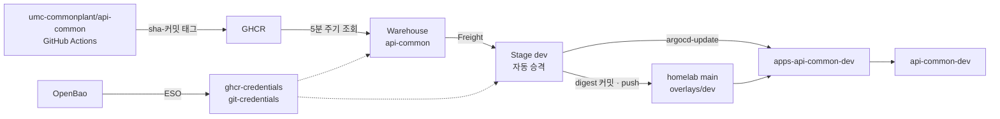

# Kargo 이미지 승격

CommonPlant 애플리케이션 이미지를 Kargo로 환경별 GitOps overlay에 승격하는 구성을 정리한다.
각 구성 요소가 어떻게 동작하는지, 이 환경에서 왜 이렇게 구성했는지, 구성 중 바꾼 결정을 함께
기록한다. 운영 절차와 명령은 [Kargo README](../../gitops/platform/kargo/README.md)를 기준으로 한다.

현재 상태는 **dev 자동 승격과 UI 로그인 동작 확인**이다. GHCR 이미지로 Freight가 만들어지고 dev
Promotion이 성공해 새 digest가 `api-common-dev`에 배포됐다. `https://kargo.okbear.dev`에서 Dex SSO로
로그인된다. 다음 단계는 prod 승격이다.

## 구성 의도

| 원칙 | 구성에 드러나는 방식 |
| --- | --- |
| 앱 CI는 홈랩 저장소를 모른다 | 앱 CI는 테스트와 GHCR 이미지 발행까지만 한다. homelab 저장소 쓰기는 Kargo만 가진다. |
| 한 번 빌드한 이미지를 그대로 올린다 | 승격 단위는 mutable tag가 아니라 Freight가 가리키는 image digest다. prod는 dev에서 검증한 Freight만 받는다. |
| 환경 설정은 승격하지 않는다 | ConfigMap, Secret, DB endpoint, domain은 각 overlay에 남기고 이미지 digest만 바꾼다. |
| 파이프라인은 앱 옆에 둔다 | 컨트롤러는 `platform/kargo`, 앱별 Project·Warehouse·Stage는 `apps/<앱>/kargo`에 둔다. |
| credential은 앱 단위로 분리한다 | token 소유자와 폐기 범위가 앱마다 다를 수 있으므로 Project namespace마다 따로 둔다. |
| 값은 Git에 남기지 않는다 | GHCR token과 GitHub App key는 OpenBao에 두고 ESO가 Secret으로 동기화한다. |

## 한눈에 보기

## 구성 요소

| 리소스 | 위치 | 역할 |
| --- | --- | --- |
| Kargo chart `1.11.0` | `platform/kargo/values.yaml` | CRD, controller, management controller, webhook, garbage collector |
| `Project` `kargo-api-common` | `apps/api-common/kargo/project.yaml` | 기존 namespace를 채택. 삭제해도 namespace는 유지(`keep-namespace`) |
| `ProjectConfig` | 같은 파일 | dev Stage만 자동 승격 |
| `Warehouse` `api-common` | `warehouse.yaml` | `^sha-[0-9a-f]{40}$` 태그만 수집, 빌드 시각 기준 최신(`NewestBuild`), 조회 5개 제한 |
| `Stage` `dev` | `stage-dev.yaml` | Warehouse에서 직접 Freight를 받아 dev overlay에 반영 |
| SA, SecretStore, ExternalSecret 2개 | `external-secrets.yaml` | OpenBao에서 GHCR·Git credential을 가져온다 |

처음에는 API/UI를 끄고 controller만 설치했다. 이후 `https://kargo.okbear.dev`로 UI를 열고 Dex
OIDC로만 로그인하게 했다. Kargo는 PKCE를 쓰므로 Dex client는 secret이 없는 public client이고,
로컬 admin 계정과 UI의 Secret 관리 기능은 끈다. `platform-admin`은 admin, `common-backend`는
viewer다. external webhook은 계속 끈다.

### dev Stage 단계

| 단계 | step | 내용 |
| --- | --- | --- |
| 1 | `git-clone` | homelab `main`을 `./src`로 받는다 |
| 2 | `kustomize-set-image` | `gitops/apps/api-common/overlays/dev`의 이미지를 Freight digest로 고정한다 |
| 3 | `git-commit` | `[Chore] api-common dev 이미지 승격 (<tag>)` 메시지로 커밋한다 |
| 4 | `git-push` | `main`에 push한다. 기본 정책은 충돌 시 rebase(`AlwaysRebase`)다 |
| 5 | `argocd-update` | `apps-api-common-dev`를 sync한다. health는 Application의 Synced/Healthy만 본다 |

`argocd-update`가 동작하려면 대상 Application에 `kargo.akuity.io/authorized-stage:
kargo-api-common:dev` annotation이 있어야 한다. root-app의 `api-common-dev` 항목에 선언했다.
dev overlay의 이미지는 Kargo가 관리하므로 수동으로 바꾸지 않는다.

## 배포 단위와 순서

| Wave | Application | AppProject | 내용 |
| ---: | --- | --- | --- |
| -100 | `argocd-control-plane` | `default` | `kargo-pipelines` AppProject, argocd namespace의 Kargo RBAC |
| -50 | `namespaces` | `platform` | `kargo*` namespace와 Project 라벨 |
| -35 | `platform-cert-manager` | `platform` | webhook 인증서 발급 |
| -11 | `platform-kargo` | `platform` | Kargo chart |
| -10 | `platform-kargo-route` | `platform` | `kargo.okbear.dev` HTTPRoute |
| 30 | `apps-api-common-dev` | `apps-dev` | 승격 대상 workload |
| 30 | `apps-api-common-kargo` | `kargo-pipelines` | Project, Warehouse, Stage, credential |

### AppProject

Kargo `Project`는 cluster-scoped 리소스다. `apps-dev`/`apps-prod`는 cluster 리소스를 모두
막고, 파이프라인은 dev와 prod에 걸쳐 있어 한 환경 AppProject에 속하지도 않는다. 처음에는
`platform` AppProject로 배포했지만 `platform`은 모든 리소스를 허용해 앱 파이프라인에는 범위가
너무 넓었다. 그래서 전용 `kargo-pipelines`를 두었다.

| 허용 | 내용 |
| --- | --- |
| destination | `kargo-api-*` namespace |
| cluster 리소스 | `kargo.akuity.io/Project`만 |
| namespace 리소스 | ProjectConfig, Warehouse, Stage, PromotionTask, ServiceAccount, SecretStore, ExternalSecret |

### Namespace

namespace 구분은 Kargo chart의 설계를 따른다. Namespace metadata는 `platform/namespaces`가
소유하고 chart는 RBAC만 만든다. 기존 namespace를 Project로 쓰려면
`kargo.akuity.io/project: "true"` 라벨이 있어야 하므로 namespace chart에 추가 label을 지정할
수 있게 했다.

| Namespace | 용도 | 현재 |
| --- | --- | --- |
| `kargo` | controller, API Pod. `gatewayAccess: public` | 사용 |
| `kargo-api-common` | Project namespace. Warehouse, Stage, Freight, Promotion, credential | 사용 |
| `kargo-shared-resources` | 모든 Project가 읽는 공용 Secret | 미사용 |
| `kargo-system-resources` | ClusterConfig(클러스터 단위 webhook receiver)가 참조하는 Secret | 미사용 |
| `kargo-cluster-secrets` | `kargo-system-resources`의 이전 이름 | 미사용. 1.12에서 제거 예정 |

## Credential

Kargo는 `kargo.akuity.io/cred-type` 라벨이 붙은 Secret을 `repoURL`로 찾는다. Project
namespace를 먼저 보고 없으면 `kargo-shared-resources`를 본다. 정확한 URL이 정규식보다 우선한다.
ExternalSecret은 OpenBao 값을 그대로 받고 template으로 라벨과 `repoURL`만 붙인다
(`mergePolicy: Merge`).

| Secret | 용도 | 인증 방식 | OpenBao 경로 |
| --- | --- | --- | --- |
| `ghcr-credentials` | Warehouse의 GHCR 조회 | classic PAT (`read:packages`) | `platform/kargo/api-common/ghcr` |
| `git-credentials` | Stage의 homelab clone·push | GitHub App | `platform/kargo/api-common/git` |

OpenBao policy와 Kubernetes Auth role은 `kargo-api-common`이고 SA
`eso-kargo-api-common`, namespace `kargo-api-common`, audience `openbao`에 묶는다. 명령은
[Kargo README](../../gitops/platform/kargo/README.md#credential)에 있다.

### 인증 방식 선택

| 대상 | 선택 | 이유 |
| --- | --- | --- |
| GHCR | classic PAT | GHCR은 fine-grained PAT와 GitHub App token을 받지 않고, Kargo image credential도 App 인증을 지원하지 않는다. 지금은 개인 계정으로 시작하고 조직 봇 계정(package Read만)으로 바꾼다. |
| homelab Git | GitHub App | Kargo가 1시간짜리 installation token을 발급받아 만료 관리가 필요 없고 사람 계정과 분리된다. |
| SSH deploy key | 쓰지 않음 | Kargo가 SSH 인증을 1.10에서 deprecated로 지정했고 1.13에서 제거한다. PR 생성도 불가능하다. |

GitHub 권한 모델은 저장소 단위가 최소다. GitHub App도 Contents: Read and write이면 homelab
저장소 전체에 쓸 수 있으므로 App 전환은 권한 축소가 아니라 token 관리 개선이다. 쓰기 범위를
더 줄이려면 PR 기반 승격과 ruleset, 또는 overlay 저장소 분리가 필요하다.

## 구성 중 바꾼 결정

### Argo CD RBAC 중복

Kargo chart는 `argocd` namespace에 `kargo-controller` Role/RoleBinding을 만든다. 같은 이름의
리소스를 `argocd-control-plane/kargo-controller-rbac.yaml`이 이미 소유하고, `platform`
AppProject는 `argocd`를 destination으로 허용하지 않는다. 그대로 두면 `platform-kargo` sync가
실패하거나 두 Application이 같은 리소스를 두고 충돌한다. values에서
`argocd.dataPlane.install`과 `argocd.dataPlane.kargoController.install`을 모두 끄고 기존
파일만 남겼다. Role과 RoleBinding의 렌더 조건이 달라 하나만 끄면 리소스 하나가 남는다.

### 파이프라인 위치: platform → apps

처음에는 `platform/kargo/projects/api-common`에 두고 `platform` AppProject로 배포했다. 경로를
platform에 둔 실제 이유는 AppProject 제약이었고 경로 자체와는 관계가 없었다. 전용 AppProject를
만들면서 파이프라인을 앱 옆(`apps/api-common/kargo`)으로 옮겼다.

### credential: SOPS → OpenBao, 공용 → 앱별

처음에는 KSOPS로 암호화한 Secret을 쓰려 했지만 다른 플랫폼 Secret과 같이 OpenBao + ESO로
바꿨다. token 교체가 OpenBao 값 변경만으로 끝나고 Git 커밋이 필요 없다.

이후 `kargo-shared-resources`에 정규식 `repoURL`로 조직 전체 GHCR credential을 한 번만 두는
구조도 검토했다. 앱마다 저장소 구성이 다르거나 내가 관리자가 아닌 조직의 token을 받아야 할 수
있어 Project별 credential로 되돌렸다. 앱을 추가할 때 파일 하나와 OpenBao policy·role이 늘지만
token 소유자와 폐기 범위가 앱 단위로 분리된다.

### Git credential: fine-grained PAT → GitHub App

fine-grained PAT는 만료마다 교체해야 하고 개인 계정에 묶인다. GitHub App으로 바꿨다. 같은
저장소에 push하는 다른 Project도 같은 App을 쓰되 private key를 Project마다 따로 생성하면
앱 단위로 key를 폐기할 수 있다. 승격 커밋 작성자는 App이 아니라 Kargo `gitClient` 설정(기본
`Kargo <no-reply@kargo.io>`)을 따른다.

### Stage health: desiredRevision 제거

첫 Promotion은 성공했지만 dev Stage가 Unhealthy로 남았다. `argocd-update`에 `desiredRevision`(승격
커밋)을 지정하면 Kargo는 Application이 그 커밋에 **정확히** sync되어야 Healthy로 본다.
`apps-api-common-dev`는 `main`을 따라가므로 승격 뒤 다른 PR이 merge되면 sync 리비전이 바뀐다.
실제로 승격 커밋 `cd1b93d` 뒤에 #327 merge 커밋 `e6b6b3b`로 sync되어, 앱은 Synced·Healthy인데
Stage만 Unhealthy였다.

`desiredRevision`을 뺐다. Kargo 1.1부터 이 값이 없으면 특정 리비전을 요구하지 않고 Application의
Synced·Healthy만 확인한다. 승격 커밋은 main에 push된 뒤 sync되므로 이후 커밋에도 포함된다.

환경별 브랜치(`env/dev`)에 Kargo만 커밋하는 방식이면 리비전이 항상 맞지만, 사람이 고치는 overlay
변경 경로를 따로 설계해야 해서 택하지 않았다. 대신 승격 직후 Argo CD가 새 커밋을 반영하기 전에
잠깐 Healthy로 보일 수 있으므로, prod 승격 판단에는 verification(smoke test)을 함께 둔다.

### UI 로그인: Dex CORS

UI는 떴지만 SSO 버튼에서 `OIDC: Failed to fetch`로 실패했다. Kargo UI는 PKCE SPA라 브라우저가 Dex의
discovery와 token endpoint를 직접 호출한다. Dex가 `kargo.okbear.dev` origin을 허용하지 않아 브라우저가
응답을 막았다. 서버에서 Dex를 호출하는 Argo CD, Grafana, OpenBao에는 없던 요구 사항이다. Dex
`web.allowedOrigins`에 `https://kargo.okbear.dev`를 추가했다(hweyoung/homelab#330).

`platform-kargo-route`는 처음 배포 직후 Degraded였고 다시 sync하자 정상이 됐다. 원인은 따로 확인하지
않았다. 같은 증상이 반복되면 HTTPRoute의 `status.parents` 조건과 `kargo` namespace의
`gateway-access` 라벨을 먼저 본다.

### PR 기반 승격 보류

Kargo가 `main`에 직접 push하지 않고 PR을 열게 하면 ruleset으로 `main` 변경을 막을 수 있다.
하지만 승격 판단은 이미 Kargo의 Stage와 Freight 검증이 맡고 있어 PR merge가 같은 역할을
반복한다. dev는 직접 push를 유지하고, prod Stage를 만들 때 승인 방식을 다시 정한다.

### CI 평문 Secret 검사

ExternalSecret template에 `password: "{{ .password }}"`를 쓰면 CI의 평문 Secret 정규식에
걸린다. template은 `repoURL`만 정의하고 `mergePolicy: Merge`로 원본 키를 그대로 합쳤다.

### Warehouse OutOfSync

배포 후 `apps-api-common-kargo`에서 Warehouse만 OutOfSync로 남았다. Kargo 1.11의 Warehouse
defaulting webhook은 image subscription의 빈 값을 채운다(`imageSelectionStrategy: SemVer`,
`strictSemvers: true`, `discoveryLimit: 20`). `spec.subscriptions`는 `apiextensionsv1.JSON`으로
저장되어 Argo CD가 subscription 항목을 통째로 비교하므로, 매니페스트에 없던 `strictSemvers: true`가
차이로 잡혔다. 나머지 필드는 `omitempty`라 추가되지 않는다.

`warehouse.yaml`에 `strictSemvers: true`를 명시했다. `NewestBuild`에서는 동작에 영향이 없다.
수정은 hweyoung/homelab#327로 merge했고, 실클러스터 diff로 다른 필드가 없는지 확인한다. 새 앱의 Warehouse도 webhook 기본값이
있는 필드는 처음부터 명시한다.

## 검증

### 정적 검증

| 항목 | 결과 |
| --- | --- |
| root-app 렌더 | `platform-kargo`, `apps-api-common-kargo`의 project, path, wave, annotation 확인 |
| Kargo chart 렌더 | `argocd` namespace 리소스 0개 |
| kustomize build | `apps/api-common/kargo` 리소스 8개, 모두 `kargo-pipelines` whitelist 안 |
| CRD schema | Kargo 1.11.0, ESO 2.9.0 CRD 기준 필드 확인 |
| CI 검사 | 평문 Secret, placeholder, `git diff --check` 통과 |

### 실클러스터

| 항목 | 결과 |
| --- | --- |
| OpenBao 값, policy, role | 입력 완료 |
| SecretStore, ExternalSecret 2개 | Synced, Healthy |
| Project, ProjectConfig, Stage, SA | Synced |
| Warehouse | OutOfSync → `strictSemvers` 명시(#327) |
| Freight 생성 | `b1db445` 생성 |
| dev Promotion | `Succeeded`. 승격 커밋 `cd1b93d`가 main에 push되고 Application sync 성공 |
| `apps-api-common-dev` | Synced, Healthy, Pod Running |
| dev Stage health | Unhealthy(리비전 불일치) → `desiredRevision` 제거(#329). 새 설정은 다음 Promotion부터 적용 |
| `platform-kargo-route` | 첫 배포 직후 Degraded, 재sync 후 정상 |
| Kargo UI SSO | CORS로 실패 → Dex `allowedOrigins` 추가(#330) 후 로그인 성공 |

배포 후 확인 순서와 완료 기준은 [Kargo README](../../gitops/platform/kargo/README.md)의 api-common 배포 후 확인을
따른다. SecretStore와 ExternalSecret Ready → Warehouse Freight 생성 → dev Promotion
`Succeeded` → `main` 승격 커밋 → `apps-api-common-dev` sync 순으로 본다.

## 한계와 후속 작업

- #329 이후 Promotion에서 dev Stage가 Healthy로 남는지 확인해야 한다. health 설정은 Promotion 때 등록되므로
  같은 Freight를 다시 Promote하거나 다음 이미지 승격을 기다린다.
- Kargo CLI(`kargo login --sso`) 로그인은 확인하지 않았다.
- dev 배포 뒤 HTTP smoke test(verification)가 없다.
- prod workload, `api-common-prod` Application, prod Stage와 승인 방식이 없다.
- GHCR token은 개인 계정 classic PAT다. 조직 봇 계정으로 옮겨야 한다.
- rollback은 과거 검증 Freight 재승격으로 하되 절차를 아직 정리하지 않았다.
- 1.12 업그레이드 전에 `kargo-cluster-secrets` 정리와 `pushIntegrationPolicy` 기본값 변경을
  확인해야 한다.
